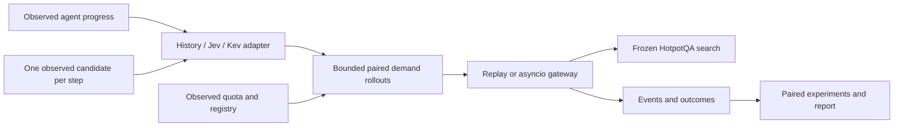

# Architecture

## Implemented system

The proposal asks whether agents' observed progress helps estimate the harm of
spending shared quota before other agents submit their required calls. Quota is
spent on dispatch, with no completion/cancellation refund.

| Module | Responsibility |
| --- | --- |
| `models.py` | Ground truth traces and separate immutable observed snapshots |
| `quota.py` | Aligned fixed windows, monotonic ledger advancement, spend at dispatch |
| `replay.py` | Dependency-aware events, exact reuse, FIFO/progress dispatch and privileged reference |
| `policies.py` | No speculation, current capacity, fixed and observed-usage reserves |
| `prediction.py` | Bounded forecast schema, development-only history and calibration |
| `admission.py` | Shared-scenario bounded counterfactuals and estimated deadline risk |
| `adapters.py` | Total-timeout Jev/Kev System One contracts and inference telemetry |
| `gateway.py` | Single-process atomic live registry/reservation and HTTP factory |
| `search.py`, `collect.py` | Checksummed BM25 corpus and observed scripted trace collection |
| `experiments.py`, `live.py` | Tuning, held-out sweeps, bootstrap and live fidelity checks |

Jev/Kev adapters have mock contract tests; real inference is unavailable. The
frozen traces use scripted retrieval, not a main LLM. `qa.py` provides a bounded
main-model HTTP integration and a synthetic mock. Real measurements remain
outstanding; see `API_SETUP.md` and `MODEL_ACCESS.md`.

## Online boundary

`Observation` contains current time, candidate, task ID/progress, remaining quota,
and queued required count. Its `Snapshot` contains only arrived active agents,
observed deadlines/context, phase/timestamps, eight recent calls, bounded prior
result excerpts, current registry and required queue. Running executions expose estimates based on already completed calls, or the
configured initial duration estimate; true uncompleted durations remain hidden.
The simulator owns hidden
future arrivals, required identities, durations and dependencies. Online policies
never receive the ground-truth `Task` or `Step` objects.

A result excerpt stored in a trace step becomes visible only after that step
completes. Candidates are available at step entry and generated from the question
and previous observed search results. No gold answer or supporting-fact label
is passed to the generator/predictor. History fitting uses development labels;
held-out labels are inspected only by evaluation/calibration code.

`bounded_context` validates observation times and supports nested task, history
and progress context plus history/progress removal modes. It caps task text at
2,048 characters and result excerpts at 1,024. HTTP request bodies are bounded.
The history baseline conditions on completed-call count; it does not interpret
question semantics. Jev/Kev supply probabilities using the same timing samples.

## Forecast and paired objective

Each `Forecast` holds reuse, next-call and continuation probabilities, plus at
most 128 nonnegative finite timing samples. Admission bounds samples to 256 and
predicted calls per active agent to 16. The current experiment uses eight samples
and four calls. Predictions represent currently observed agents only; unannounced
future arrivals are not modeled.

For each candidate, a stable identity/seed generates K demand scenarios once.
Each scenario is replayed twice with identical required demand: admit now or
reject. Both branches preserve current spent quota, fixed-window refills,
observed queued/running executions, exact cached reuse, and dependency-shifted
readiness. Quota waiters keep FIFO priority even over new arrivals at a refill.
Hypothetical unmatched calls have distinct per-agent/step identities.

The gain is the sum across agents of reject-branch projected chain completion
minus admit-branch completion, with both endpoints censored at horizon H.
The owner-only ablation changes only that gain sum; scenarios and the global
risk guard stay the same. A decision cost is subtracted. History/mock runs use a fixed cost; external
predictors charge measured decision wall time, including failed inference. The frozen
study cost is the development p95 scheduler wall time, rounded up to milliseconds
with a 1 ms minimum. Actual decision wall time is also logged separately.

For each observed deadline at or before now+H, count a newly introduced miss
(admit misses, reject meets). Risk divides this count by K times the number of
those deadlines. When none fall in the horizon, risk is zero. Admit only on
strictly positive gain after the overhead charge and risk <= epsilon. Forecast,
schema or timeout failure rejects; fallbacks record the failure type. This
conservative newly-missed metric does not offset harm with rescued deadlines.

Projected chain endpoints are approximations, and censored/incomplete demand
can misestimate true task completion and deadline risk. H must be long enough
for relevant contention. Unknown arrivals, prediction error, timing variance,
finite samples and registry estimates prevent arbitrary-arrival guarantees.

## Execution invariants and timing

Required FIFO priority stays fixed across admission comparisons. Progress-aware
required ordering is a separate no-speculation control that prioritizes larger
observed completed-call counts; readiness and stable order break ties.

The registry key is exactly `(task_id, tool, canonical_arguments)`. Casing and
spacing matter. A matching in-flight call is joined; a completed matching result
is reused without another charge. Optional callers receive admission status
only; result contents are delivered upon a matching required request. No
cross-agent sharing, semantic matching or eviction is assumed.

Replay considers a candidate once at step entry and skips stale step events. It reserves quota at decision
time and adds frozen modeled overhead to the speculative completion time;
required readiness of its owner cannot precede that overhead. This conservative
reservation convention differs from the live gateway, which performs inference
before acquiring the atomic reservation lock and revalidates eligibility. Live
and replay timing therefore need measurement rather than an exact-equivalence
claim. Scheduler wall time is diagnostic; frozen overhead preserves deterministic
simulated outcomes for a saved configuration.

The future-informed reference uses a separate privileged callback. It compares
full remaining ground-truth admit/reject rollouts, fixes prior decisions, disables
undecided later speculation, requires strict mean improvement, and disallows an
increase in deadline misses. It is a greedy heuristic, not a global optimum.

## Live gateway

One asyncio lock protects registry insertion, required FIFO and quota spending.
Concurrent identical required waiters advance progress once, from worker
completion even if clients disconnect. Distinct simultaneous calls within a
task are rejected because task progress models serial chains. Task completion
explicitly releases registry entries and progress via `finish_task`.
Required requests create or join futures atomically. Model inference runs in a
worker thread outside that lock; its policy state is serialized separately.
After prediction, optional admission rechecks registry, queue, capacity, window
and state revision under the ledger lock. Stale forecasts are rejected. Required requests can proceed while a prediction runs.

Waiters await shielded futures: a disconnected/cancelled client cannot cancel
shared execution. A failed execution is removed from the registry and cannot
be reused as success. Retrying spends another unit. An execution cancelled after
dispatch retains its charge. Shutdown cancels outstanding futures/workers and
the refill wakeup. The monotonic clock is anchored at gateway construction.

Use one FastAPI worker. Multiple workers would require a shared atomic ledger
and registry. The current gateway has no persistent store or cross-process
coordination. The replay models serial task chains, not arbitrary dependency
DAGs, failures/retries, tool concurrency limits or continuous refill. The live
gateway tests failures and cancellation independently of the replay workload.
