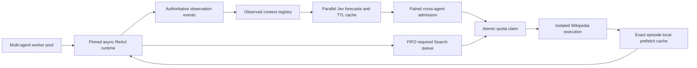
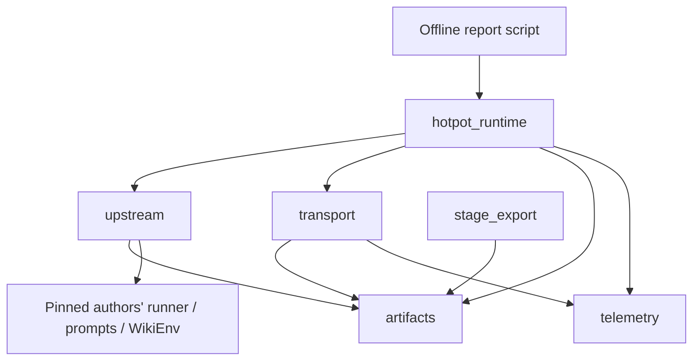

# Active baseline architecture

**November 15 live extension:** `multi_agent.py` now composes the baseline with
`context_engine.py`, `admission.py`, `quota.py`, `prediction.py` and the Jev adapter.
The registry contains only observed state; final claims atomically enforce the
shared quota and required FIFO priority. `live_context_audit.py` independently
checks forecast inputs against past events and reuses immutable capture validation.
See [the current implementation and results](MULTI_AGENT_CONTEXT_2026-11-15.md).

The standalone baseline architecture below remains intact. The historical gateway
and BM25 drivers are not used by the current multi-agent HotpotQA path.

Version 2 capture is now active by default. `capture.py` stores immutable blobs
and exact per-stage dependencies/timing; `capture_audit.py` restores/re-executes
states with sockets blocked. `capture_bank.py` completes skipped alternatives
outside live timing. `capture_cohort.py` assembles disjoint banks.
`frozen_replay.py` reuses the quota/policy/model interfaces for all candidate
ranks and continuous worker pools, and `frozen_forecasts.py` prepares existing
bounded-context inputs. These offline extensions are separate from live runtime
imports. See [the current workflow](CAPTURE_REPLAY.md).

`hotpot_runtime.py` is the single live orchestration path. Required actions use
real observations. Each speculative Search uses an isolated upstream WikiEnv;
only exact case-sensitive Search arguments can reuse or join that work.
Lookup and Finish execute locally on authoritative state. Late predictions
cannot block required work; all started model/tool work drains before the next
episode. Windows now remain open until answer readiness; exact required or
cached queries suppress duplicate speculation. Optional model requests occupy
at most three of four serving slots, leaving actor capacity. Historical
next-action expiry remains explicitly selectable. See
[the validation report](ASYNC_SPECULATION_VALIDATION_2026-11-13.md). Extraction retained these semantics and the original upstream parser.

`artifacts.py` and `telemetry.py` use only the standard library. `upstream.py`
imports HTTP tooling when preparing files and loads pinned authors' code when
requested. Authors' imports need `gymnasium`, `requests`, `beautifulsoup4` and
`pandas`; async transport uses `httpx`. Install the `paper` extra.

Before cleanup, `hotpot_runtime` imported `collect_qa.write_json`, which loaded
local-BM25 QA, speculation, workload and model modules. It also imported upstream
utilities from the serial `paper` experiment and loaded `experiments.source_hashes`,
which pulled in replay, admission and prediction. These helpers now live in
small modules. Historical imports in `collect_qa`, `experiments`, `paper` and
`hotpot_runtime.LiveChat` remain compatibility exports. There is one implementation
of each extracted helper.

## Provenance

Source: `https://github.com/naimengye/speculative-action`, revision
`dc938b9ef7474caf07fe4ad16549c1fa8c7d268c`.

| Responsibility | Source |
| --- | --- |
| ReAct instructions, six-shot examples, observation/action prompts | Pinned authors' files |
| Thought/action extraction and retry parsing | Authors' `HotPotQARun` methods |
| Search, local Lookup/Finish, normalization/F1 | Authors' WikiEnv/wrappers |
| Seeded question order | Authors' convention via `upstream.paper_indices` |
| Async episode loop, branch isolation, exact reuse, accounting | Our runtime/transport |
| Future quotas, admission and demand forecasts | Preserved project extensions |

Pinned files and their license live under `data/raw/speculative-action/<revision>`.
`upstream.json` records Git blob and SHA-256 hashes. No GitHub fork is required.
The original paid source snapshot is immutable; refactored active source has new
hashes. The offline report reports both identities without rewriting paid evidence.

## Export and next capture boundary

`stage_export.py` consumes only local JSON files. It emits model-attempt nodes,
required action boundaries, Search executions, candidate/launch events, tool
application records and answer/drain nodes. Edges never cross episodes.
Candidate ranks and exact arguments are preserved. Every raw request and event
is accounted for; all absent full tool state/results remain explicit gaps.
[The schema and coverage guide](STAGE_EXPORT.md) explains these limits.

## Preserved extension map

| Modules | Status |
| --- | --- |
| `quota`, `policies`, `admission`, `prediction`, `adapters` | Shared-quota/forecast components for future integration |
| `replay`, `models`, `workload` | Existing one-candidate replay; needs a faithful multi-candidate extension |
| `forecast_bank`, `experiments` | Frozen forecasts and sweeps; phase-entry `elapsed=0` assumption |
| `paper`, `paper_collect`, `paper_reproduction` | Serial agreement/reference measurement |
| `paper_pipeline` | Earlier top-one upstream quota adaptation |
| `collect`, `collect_qa`, `qa`, `pipeline`, `cli`, `live`, `gateway`, `search`, `preflight`, `configuration` | Historical BM25/integration harness |

These modules remain in the package to preserve tested interfaces, outside the
baseline dependency chain. Their tests are in `tests/extensions/`; baseline tests
are in `tests/baseline/`. [Historical architecture](LEGACY_ARCHITECTURE.md) retains
implementation details and earlier claims in context. The ordered integration
plan remains [next_steps.md](../next_steps.md).
