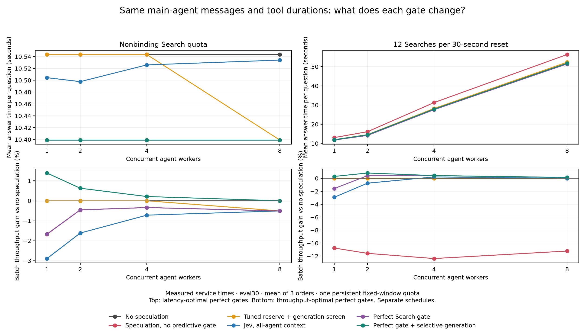
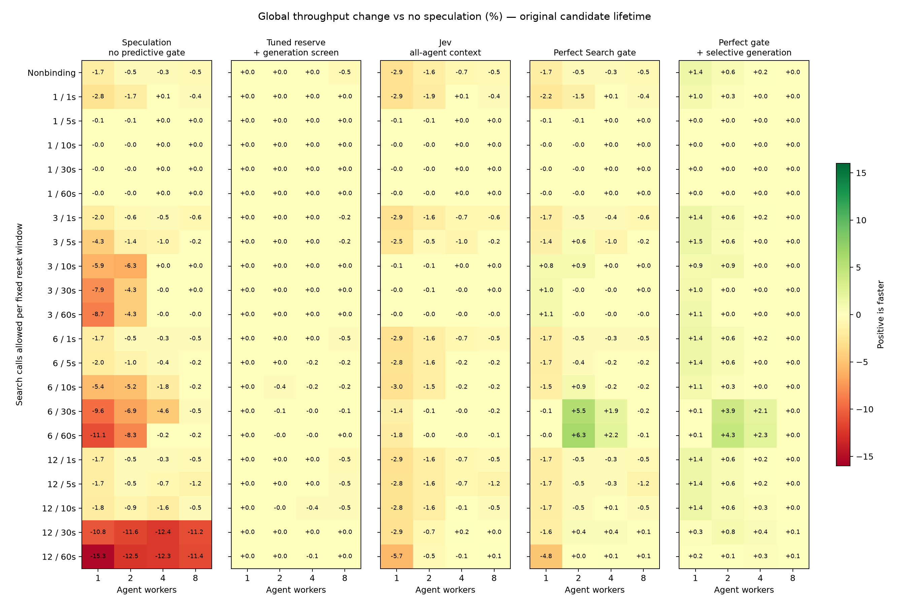
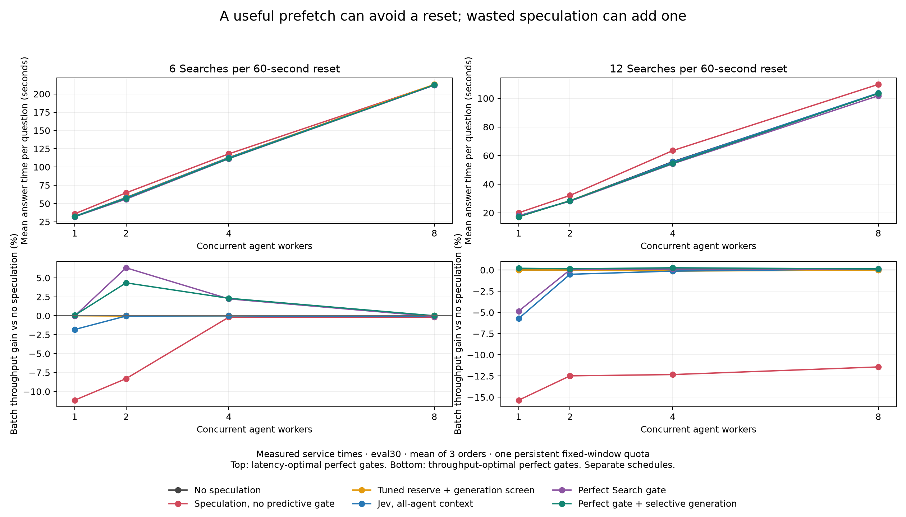
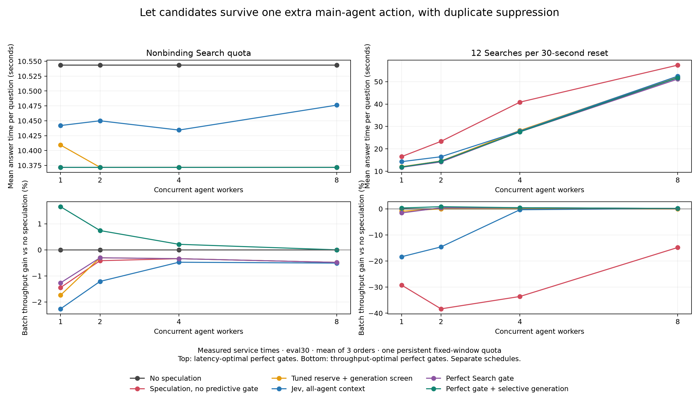

# Exact timing and global gate analysis — November 13, 2026

The saved message/tool dependencies are sufficient to calculate a consistent
counterfactual. This analysis holds every main-agent action, result and measured
service duration fixed. It compares no speculation, ungated speculation, reserve
rules, history/Jev gates and offline perfect gates under one persistent quota.

**Current Jev does not establish an overall throughput improvement.** Its largest
original-window gain across 84 quota/worker combinations is 0.21%; all four
positive cells have zero useful speculative hits. Those small changes come from
worker admission/reset phase, rather than successful prefetches. Perfect knowledge
does expose a real opportunity: the best tested original-window Search gate gains
6.32% throughput with two workers and six Searches per 60 seconds. The broad
no-quota benefit of the recorded candidates remains small, even with perfect gating.



## What was run

- Main sweep: 21 quota settings × 1/2/4/8 workers × three question orders =
  **252 settings and 3,528 policy runs**. Quotas are capacities 1/3/6/12 crossed
  with reset periods 1/5/10/30/60 seconds, plus a verified nonbinding control
  of 10,000 calls/second. All tool times are recorded, with no artificial delay.
- Original-window perfect gates: nine potentially useful on-time candidate
  decisions, **all 512 subsets**, both generation modes, in every setting.
  This evaluates **258,048 schedules**, without a greedy search approximation.
- Longer-lived follow-up: candidates survive one extra main-agent action, with
  duplicate suppression; five quota settings × four worker counts × three orders
  = **60 settings and 720 policy runs**. Twelve useful candidate decisions,
  **all 4,096 subsets**, both modes: **491,520 additional schedules**.
- Combined: **4,248 policy runs, 312 settings, 749,568 exact counterfactual
  schedules**. Additional independent per-task checks cover all 50 questions.
- Twenty development questions train history timing and tune integer reserves;
  30 evaluation questions measure outcomes. Reserve tuning minimizes full batch
  resource makespan on two development orders, separately for each quota/worker
  setting. Evaluation orders use seeds 248/249/250. This is the already-explored
  cohort, rather than a new confirmation dataset.
- Jev uses the existing 1,186-context bank and the 1,885-context extended bank.
  Saved per-response latency/cost is charged to each logical forecast use.
  Per-agent forecasts can run in parallel; the decision waits for their maximum
  saved duration. There are **zero new inference requests and $0 new inference
  spend**. Kev remains deferred per the user's instruction.

## The timing calculation

Let `a[i]` be the recorded duration of main-agent message `i`, `t[i]` its required
tool duration, and `f[i-1]` the previous required result's completion time. The next
tool request becomes known at:

```text
r[i] = f[i-1] + a[i]

Without a matching speculative result:
  d[i] = earliest quota dispatch at or after r[i], with FIFO required priority
  f[i] = d[i] + t[i]

With a completed/in-flight matching speculative execution finishing at p:
  f[i] = max(r[i], p)

Candidate generation availability:
  g = parent Search dispatch + observation duration + hypothetical duration
  candidate dispatch >= g + gate response delay
```

Local Lookup/Finish stages retain their recorded duration. Cache keys match exact,
case-sensitive Search queries within an episode. A saved result can serve multiple
later identical queries. Each actual Search, required or speculative, consumes one
token with no refund. There are at most `capacity` dispatches in each interval
`[k × reset_period, (k+1) × reset_period)`. Optional calls never displace an already
queued required call, but can consume a token needed by a future required call.

Example, question 6031 without quota pressure: the step-2 Search starts at
1.882141 s. Its observation plus hypothetical duration is 1.944168 s, so
`Search[Ohio Turnpike length]` can launch at 3.826309 s. The main agent requests
that result at 3.951351 s. The speculative tool finishes at 4.564617 s, and the
main agent joins it then. Without prefetch, the required tool would finish at
4.689660 s: **0.125042 s saved at that step**, followed by reuse on a repeated
query. The engine does not count the entire tool duration as saved.

An independent serial recurrence, with no replay event heap or quota code,
matches all **100 question/mode checks exactly** (maximum residual 0 seconds,
identical hit counts). Full schedules additionally validate quota consumption,
worker count, preserved answers and absence of forecast fallbacks.

Generation and gate work overlap the next main-agent message. Original-window
candidates expire when that message returns, rather than when it starts. The
extended study keeps them alive through one further action and suppresses calls
that have already been requested. Thus main-agent thinking does not automatically
block speculation or force the actor to await Jev.

## Two performance metrics

**Answer latency** is time from a worker accepting a question to its answer.
**Batch throughput** is 30 questions divided by the time to finish the entire
batch and drain every started model/tool/gate operation. A worker accepts its next
question only after this drain; all workers share one quota throughout the batch.
There is no quota reset between questions.

Means shown below average three orders. Throughput gains compare the average of
`30 / resource_makespan` against the corresponding no-speculation average; they
are not calculated by inverting the average makespan. Latency-optimal and
throughput-optimal perfect gates are solved separately, and can select different
calls. A lower mean answer time does not imply a faster fully drained batch.

## What “perfect” means

| Gate | Offline knowledge and controls |
|---|---|
| Perfect reuse | Knows which recorded candidates match later required Searches; admits every available matching candidate. It can still harm other agents. |
| Perfect Search gate | Enumerates every useful admit/drop subset globally and selects the best schedule. Pays every naturally started generation operation. |
| Perfect pipeline gate | Same enumeration, but generates only source windows containing a selected candidate. Every selected window still pays full measured generation time. Empty selection equals no speculation. |

The two optimized gates have zero forecast latency/cost, but never invent a
correct candidate, launch it before generation finishes, bypass quota or alter
main-agent messages. The search is exact **within these no-unused-Search,
admit/drop controls, the stated candidate lifetime, required FIFO and immediate
optional dispatch**. It is not an unconstrained optimum over arbitrary delayed
dispatch, arbitrary generation-window subsets or deliberate wasted work. Keeping
all generation work and skipping unselected generation are separate architectures;
neither must dominate the other in a finite stream because worker release times
change reset phase.

Practical gates use observed context only. Future labels enter only the isolated
offline oracle path; a test confirms they never reach online policy prediction.
History/Jev use 16 sampled future chains (up to four Searches each), a horizon of
`max(30, 2 × reset_period)` seconds and the asynchronous/nonblocking admission
objective. Forecasts are frozen at phase entry; a declared deterministic 1 ms
scheduler budget replaces machine-dependent Python timing. Provider serving
capacity is unlimited apart from the declared Search quota. These are conditional
scheduling results, not a measured production serving-capacity benchmark.

## No-quota opportunity from the recorded candidates

| Fixed path set / lifetime | No speculation mean | Speculation mean | Perfect-gate mean | Answer-time saving |
|---|---:|---:|---:|---:|
| All 50, original window | 8.902 s | 8.749 s | 8.749 s | 1.71% |
| All 50, one extra action | 8.902 s | 8.664 s | 8.664 s | 2.67% |
| All 50, whole remaining episode | 8.902 s | 8.664 s | 8.664 s | 2.67% |
| Evaluation 30, original window | 10.543 s | 10.399 s | 10.399 s | 1.37% |
| Evaluation 30, one extra action | 10.543 s | 10.372 s | 10.372 s | 1.63% |

The all-50 perfect means are exact per-task optimizations; with no quota pressure,
answer latency separates by task. Whole-episode retention is an extra no-quota
bound, not a full multi-agent quota sweep.

Recorded Search service averages **0.707 s** (median 0.717 s); observation plus
hypothetical generation averages **1.855 s** (median 1.823 s). There are 57
future-matching candidate occurrences among all 441 candidates, but only 18 can
arrive within the original window. Evaluation has 27 future matches among 253
candidates, with only nine on time. Cache hits and skipped source windows reduce
the number actually launched further. Perfect recognition cannot repair missing
or late predictions.

Original-window speculation improves 12/50 question paths and saves 7.630 total
answer seconds. Longer retention improves 17/50 and saves 11.882 seconds. The
150.150-second actor outlier is retained under every gate. Excluding its question
as a sensitivity check raises savings to 2.64% and 4.11%, respectively; the broad
conclusion does not depend only on that outlier. Removing *all* Search time would
give a much looser 6.625 s actor/local-only lower bound, but the saved predictions
cannot achieve that.

## Global throughput across worker counts

Original candidate lifetime; positive values mean faster than no speculation.
“Reserve” includes the generation screen, tuned on development questions.

| Quota | Agents | Ungated | Reserve | Jev all-agent | Perfect Search | Perfect pipeline |
|---|---:|---:|---:|---:|---:|---:|
| Nonbinding | 1 | −1.68% | 0.00% | −2.89% | −1.66% | +1.39% |
| Nonbinding | 2 | −0.46% | 0.00% | −1.62% | −0.46% | +0.63% |
| Nonbinding | 4 | −0.34% | 0.00% | −0.72% | −0.34% | +0.21% |
| Nonbinding | 8 | −0.51% | −0.51% | −0.51% | −0.51% | 0.00% |
| 12/30 s | 1 | −10.75% | 0.00% | −2.92% | −1.58% | +0.29% |
| 12/30 s | 2 | −11.58% | 0.00% | −0.75% | +0.41% | +0.82% |
| 12/30 s | 4 | −12.37% | 0.00% | +0.21% | +0.42% | +0.42% |
| 12/30 s | 8 | −11.22% | 0.00% | 0.00% | +0.13% | +0.13% |

The full 84-cell grid shows ungated speculation as much as **15.35% slower**;
Jev all-agent is as much as 5.72% slower. Jev all-agent has four positive, eleven
zero and 69 negative throughput cells. Its maximum gain is 0.21%, with zero hits.
The perfect pipeline gate has 44 positive and 40 zero cells; choosing no
speculation is always available. The tuned reserve has 64 zero and 20 negative
cells. Development tuning sometimes selects full speculation in the nonbinding
regime; the different evaluation tail then makes it slower. These cell counts
describe this sweep and are not independent statistical trials.

Tail latency remains a separate concern. At 12/30 s with four workers, the
averaged p95 answer times are 60.206 s without speculation, 69.033 s ungated,
58.094 s with all-agent Jev and 60.206 s with the throughput-optimal pipeline
gate. Jev can improve latency without improving useful speculative throughput.
At the 6/60 s, two-worker optimum below, p95 is essentially unchanged (120.391
versus 120.558 s), despite the batch throughput gain. Per-question completion and
wait measurements are retained in every raw row; summary CSV also includes p95.



## A concrete quota-reset opportunity

At **six Searches per 60 seconds and two workers**, a perfect Search gate admits
only the step-2 rank-1 candidate of question 6031 (`Ohio Turnpike length`). This
result serves repeated required requests, enough to avoid a later refill boundary.

| Method | Mean answer time | Full batch makespan | Throughput change |
|---|---:|---:|---:|
| No speculation | 58.260 s | 901.640 s | 0.00% |
| Ungated | 64.627 s | 984.058 s | −8.30% |
| Tuned reserve + generation screen | 58.248 s | 901.994 s | −0.04% |
| Jev, own-agent | 57.953 s | 902.715 s | −0.12% |
| Jev, all-agent | 57.928 s | 901.994 s | −0.04% |
| Perfect Search gate | 56.058 s | 848.011 s | **+6.32%** |
| Perfect pipeline gate | 57.021 s | 864.937 s | +4.34% |

The Search-gate optimum chooses that same single candidate in all three orders;
its makespans are 846.339, 847.596 and 850.100 s, versus baseline 901.039,
901.573 and 902.306 s. This is an actual reset-boundary effect, not a synthetic
five-second Search. In contrast, at 12/60 s with one worker, even the perfect
Search gate loses 4.85% because started generation drains after answers; the
perfect pipeline gate avoids that work and gains 0.21%.



## Keeping speculation alive after the main agent moves on

This improves no-quota answer latency a little, but opens more opportunities to
spend scarce tokens on predictions that are never used. At 12/30 s:

| Agents | Ungated throughput | Jev all-agent throughput | Perfect pipeline throughput |
|---|---:|---:|---:|
| 1 | −29.23% | −18.37% | +0.32% |
| 2 | −38.34% | −14.59% | +0.82% |
| 4 | −33.60% | −0.35% | +0.42% |
| 8 | −14.83% | +0.13% | +0.13% |

All changes are versus no speculation under the same worker count and quota.
At 12/60 s, one worker, extended ungated speculation loses 37.32% and Jev loses
24.79%. Overlap removes a serial wait on the actor, but cannot remove the cost of
wrong Search consumption or late work draining. It does not by itself solve
global admission.



## Interpretation and next implementation target

These traces support a **small direct overlap opportunity and occasional larger
reset avoidance**, rather than a broad current Jev speedup. Correct reuse alone
is insufficient: a globally useful gate must price the token against other
agents' upcoming required demand. A regression test demonstrates a correct
prefetch raising two-agent mean latency from 7.1 to 7.6 seconds under quota 3/10;
the exact global gate rejects it.

The most useful next target is a cheap generation screen plus a deadline-aware
admission rule: reject candidates already requested; compare remaining generation
and forecast time with the next useful request; account for quota remaining,
time to refill and competing required demand. Keep the all-agent forecast only
where it changes that decision enough to repay its latency and work. The 6031
case is a concrete positive target; the long-window persistence cases are
concrete harm cases. A new rule should be tuned on development data and compared
against both no speculation and the reserve, rather than only ungated or
own-agent admission. A fresh paired live cohort is needed before claiming a
general deployed speedup.

The earlier 20.5% comparison used **synthetic five-second Searches** and measured
protection against own-agent admission. It did not show a 20.5% improvement over
no speculation; the earlier reserve/no-speculation comparisons were stronger.
This report uses native measured tool durations throughout. The original live
20-pair 10.27% result also remains a separate comparison with independently
generated main paths; see the [discrepancy audit](SPECULATION_DISCREPANCY_2026-11-13.md).

## Evidence, verification and reproduction

- [All original-window tables](FULL_GATE_TABLES_2026-11-13.md) and
  [all extended-lifetime tables](FULL_GATE_EXTENDED_TABLES_2026-11-13.md).
- Raw main results: `results/full-gate-analysis-2026-11-13/`; extended results:
  `results/full-gate-analysis-extended-2026-11-13/`. Each contains configuration,
  reserve tuning evidence, policy rows, exact subset scores, summary CSV/JSON and
  completion counts. The main folder also contains independent arithmetic,
  whole-episode no-quota bounds and three complete representative event schedules.
- **203 tests pass**, Ruff lint and formatting pass. Network connections are
  blocked during studies and oracle evaluation. The evidence audit verifies
  **14,816 capture/data files + 40 original Jev files + 27 asynchronous Jev files**
  against their prior checksums; none changed.
- Main-run source snapshots preserve the exact source before adding the extended
  helper parameters. Defaults are unchanged; final source is bundled as well.
- [Bundle manifest](FULL_GATE_MANIFEST_2026-11-13.json) records the archive,
  per-file inventory, forecast-bank hashes and verification results.

Use fresh output directories for studies; the audit and report regenerate only
derived analysis artifacts. Commands do not request model inference:

```sh
.venv/bin/python -m quota_spec.gate_study results/hotpot-dataset-50 \
  --bank results/hotpot-jev-progress-50/bank.json --output results/gates-fresh
.venv/bin/python -m quota_spec.gate_lifetime_study results/hotpot-dataset-50 \
  --bank results/hotpot-jev-persistent-progress-50/bank.json \
  --output results/gates-extended-fresh
.venv/bin/python scripts/audit_gate_study.py results/gates-fresh
.venv/bin/python scripts/report_gate_study.py results/gates-fresh \
  results/gates-extended-fresh --output docs/figures
.venv/bin/python -m unittest discover -s tests -v
.venv/bin/ruff check src tests scripts
```
