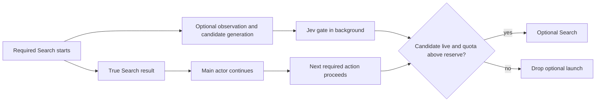

# Asynchronous Jev gating, persistent candidates and shared-quota budgets

**Allowing Jev to finish while the main actor keeps working is the right execution
model. It increases speculation opportunities, but these traces still do not show
a general throughput advantage from Jev over simpler policies.** The most useful
engineering change here is budgeting optional work before candidate generation,
then checking the quota again after asynchronous gating.

This follow-up implements and tests the proposed overlap extension. It adds
**7,098 replay runs**, freezes **699 additional Jev contexts** for **$0.019654908**,
and preserves all earlier forecasts and capture evidence. No Kev calls were made.

## What the previous implementation actually did

The live single-agent baseline and frozen scheduler already let observation
prediction, hypothetical action generation and an optional gate run during the
next authoritative actor call. Starting that actor did **not** invalidate a
prediction window. Returning its chosen action did.

The earlier admission objective was conservative in two additional ways:

1. It could postpone the proposing actor's forecast required-call readiness until
   after inference, even though the actual actor continued independently.
2. It required the predicted benefit to exceed the entire Jev inference duration,
   despite also delaying speculative dispatch by that duration inside the rollout.

The new `AdmissionConfig(nonblocking=True)` keeps authoritative readiness
unchanged, schedules optional launch only after measured inference/scheduler time,
and applies a 1 ms minimum useful-benefit threshold. Inference latency is still
charged through the delayed launch and background drain. It is **not set to zero**.
The original objective remains an explicit paired control.

A deterministic regression test demonstrates the distinction: inference takes
0.4 s, required demand arrives at 0.6 s and the tool takes 0.2 s. A background
launch can save 0.2 s even though that is less than inference latency. Conversely,
if the required call arrives at 0.1 s, a 0.4 s forecast cannot manufacture a hit by
postponing it; that test rejects the optional launch.

## Implemented scheduling variants



- **Overlap:** correct the objective above, keeping the original candidate expiry.
- **Persistence:** allow a candidate to survive **one further returned actor
  action**. This includes late completion of observation/hypothetical generation,
  and Jev that finishes after the next action has already been selected.
- **Duplicate suppression:** do not launch an optional Search already dispatched
  for the same task/query, or already held in its speculative cache.
- **Dispatch revalidation:** required FIFO priority, task/lifetime validity,
  duplicate status and remaining shared quota are checked at actual launch time.
  Optional reset revalidation permits launch in a new window when those checks
  pass; it does not refresh stale forecast probabilities or promise risk guarantees.
- **Reserve-backed hybrid:** apply a development-tuned reserve before calling Jev
  and again when its delayed decision finishes.
- **Generation budget:** apply that cheap shared-quota reserve **before starting
  observation/candidate models**, avoiding optional work that cannot use quota.
- **Detached background:** separately test releasing a question worker at answer
  time while its already-started background work drains. Spent quota remains
  spent, and final throughput still includes the complete resource drain.

The actor's required calls always proceed independently of Jev. A gate that
returns after the same required Search has started cannot accelerate that call;
it is discarded. A still-live different candidate may help a later step.
Finished tasks never launch new speculation.

These options are implemented in `admission.py`, `frozen_replay.py` and
`forecast_study.py`; `async_study.py` runs controlled comparisons. Defaults retain
the original scheduling behavior. The live single-agent capture runtime remains
unchanged: **this is a scheduling-replay experiment, not a new live multi-agent
serving benchmark**.

## Forecast coverage and experiment protocol

The original 1,186 exact forecasts are reused without new inference; their
inputs, probabilities, timings and costs are unchanged.
Another **699** cover observed phases reached by one-step persistence, producing
**1,885** unique contexts in `results/hotpot-jev-persistent-progress-50/`. New calls
all returned `typesafe/jev-1.14-20261014`, with no failures or retries. New-context
mean/median/p95/max client latency is **0.322/0.246/0.548/1.959 s**. Full responses,
usage, billed costs and latency are retained. Seeded costs are identified
separately from new charges. Total Jev spending across both studies, including
the original probe, is **$0.049769580**, provider-reported.

Persistent forecasts use the **currently observed** phase/history and only
completed results. The completed parent result is visible during subsequent
thinking; a running successor's result remains hidden. Demand and conditional
reuse labels remain outside runtime predictor inputs. Phase-entry `elapsed=0`
remains the finite-context approximation. Missing contexts fail explicitly.

All studies use the same 20 development / 30 exploratory evaluation questions.
Reserve tuning examines every integer 0..capacity on development data and two
order seeds; no evaluation labels choose the reserve. Variants were designed
while exploring this already-used cohort and require fresh confirmation.

| Study | Evaluation replays | Protocol |
| --- | ---: | --- |
| Native timings | 6,000 | 25 quota settings x 1/2/4/8 workers x 5 order seeds x 12 variants |
| Synthetic 5-second Search | 756 | Capacities 6/12, resets 5/30/60 s, 1/4/8 workers, 3 seeds, 14 variants |
| Native generation-budget follow-up | 216 | Same 6 quota settings, 4/8 workers, 3 seeds, 6 variants |
| Longer stream | 126 | 300 repeated tape instances, 3 quota settings, 4/8 workers, 3 seeds, 7 variants |

Every replay blocks network sockets and validates quota usage, worker
release/drain, saved answers and absence of predictor fallback. Required FIFO
priority is preserved by the dispatch queue and covered by regression tests.
Model/tool serving uses fixed recorded durations and unlimited serving capacity.
All background overhead is recorded. There is no latency-zero Jev variant here.

## Native results: many more launches, little throughput benefit

Across **75 multi-agent quota/worker settings**, geometric mean throughput changes
are descriptive averages over equally weighted settings, not a production traffic
mix or a population confidence interval.

| Change | Throughput versus old Jev full | Throughput versus classic tuned reserve |
| --- | ---: | ---: |
| Correct overlapping objective only | -0.004% | -0.099% |
| One-step persistence + corrected objective | -0.553% | -0.648% |
| Persistent reserve-backed Jev | +0.058% | -0.037% |
| Persistent Jev, release worker at answer | +0.201% | +0.106% |
| Persistent reserve only, release at answer | +0.210% | +0.115% |

The cheaper reserve-only detached variant matches or slightly exceeds Jev's
aggregate effect. Removing the conservative objective changes launches
substantially, but barely changes multi-agent throughput.

Across the **500 runs for each variant** in the broad native study:

| Jev full variant | Optional Searches | Cache hits | Unused Searches | Launches after next action returned |
| --- | ---: | ---: | ---: | ---: |
| Previous objective/window | 9 | 1 | 8 | 0 |
| Correct overlapping objective | 692 | 217 | 475 | 0 |
| One-step persistence | 7,831 | 734 | 7,097 | 7,088 |
| Persistence with reserve floor | 4,694 | 431 | 4,263 | 4,235 |

Persistence makes the mechanism work, but about **90.6% of its optional Searches
are unused**. Those calls can harm other agents until quota refills. The worst
native setting for persistent Jev full versus the tuned reserve loses **19.45%
throughput**: two workers, 12 calls/60 s. Mean completion is 35.113 s versus
28.348 s for the reserve.

Cross-agent protection remains useful once these extra opportunities exist.
At **four workers, 12 calls/30 s**, persistent own-agent Jev takes **32.828 s**
mean, while persistent full Jev takes **28.352 s**: **13.6% lower mean completion**
and about **17.5% higher throughput**. The classic reserve is still slightly
better at **28.254 s**. Thus the extension strengthens the cross-agent ablation,
without establishing incremental value from Jev over a cheap controller.

One-agent persistent own/full controls have identical optional-call counts in
all 125 native paired seeds. CPU timing is measured per run; minor threshold
changes in reruns are possible and exact rows are retained.

## Budgeting before generation saves work

In the focused native sweep, compare 36 runs per variant:

| Variant | Observation-model calls | Hypothetical-model calls | Logical Jev requests | Optional Searches | Cache hits |
| --- | ---: | ---: | ---: | ---: | ---: |
| Persistent reserve-backed Jev | 3,130 | 3,094 | 354 | 49 | 3 |
| Same pipeline with generation budgeting | 328 | 325 | 174 | 27 | 0 |
| Budgeted reserve, without Jev | 326 | 323 | 0 | 49 | 8 |

The budgeted Jev pipeline uses about **89.5% fewer optional model calls** and
50.8% fewer logical Jev requests. These are saved replay stage executions,
not newly observed dollar savings from a live provider run. The variants share
the same development tuning rule; the early-budget reserve is tuned for the
whole budgeted pipeline, so this table describes the package rather than a
single-parameter causal ablation.

Budgeted Jev improves aggregate throughput only **0.10%** versus the classic
reserve in this focused grid; the cheaper budgeted reserve reaches essentially
the same aggregate throughput. Jev itself adds no useful cache hits in these
36 native runs. This is a resource-efficiency result, not a convincing speedup.

## Slower Search: overlap helps locally, but can also admit more harmful calls

With synthetic 5-second Search, four workers and **12 calls/5 s**, correcting the
objective changes Jev mean completion from **21.395 to 20.903 s** and throughput
from **0.15452 to 0.15731 questions/s**, a **1.81% throughput improvement**.
A tuned reserve reaches **20.602 s / 0.15793 questions/s**, still stronger.

At the tighter **12 calls/30 s**, the same correction makes Jev worse:
**33.188 to 36.433 s**. Allowing more speculation exposes quota costs instead of
solving them. A reserve-backed Jev gate restores **30.157 s**, near the reserve's
**30.153 s**; no speculation is **29.549 s**. Faster or more permissive gating
is not sufficient when reuse predictions are weak.

## Finite-batch tail effect and the longer stream

One evaluation tape contains a **150.150-second authoritative actor call**. At
12 calls/s and eight workers, this call accounts for **93.75%** of the 160.157 s
finite-batch no-speculation makespan. Improvements to other questions cannot
substantially change that run's final completion time. This limits conclusions
about steady-state throughput from the original 30-question stream.

The diagnostic repeats the 30 evaluation tapes **ten times**, assigning each
instance a new task ID and isolated cache, shuffling the full 300-instance stream,
and keeping one shared quota throughout. The original outlier repeats too; it
is not trimmed. No new tasks, model trials or provider-capacity measurements are
introduced. Development-tuned reserves remain fixed.

Example: **four workers, 12 calls/5 s**, three paired order seeds:

| Variant | Mean completion (s) | Questions/s |
| --- | ---: | ---: |
| No speculation | 10.550 | 0.33815 |
| Classic reserve | 10.496 | 0.32979 |
| Correct overlapping Jev | 10.500 | 0.32937 |
| Persistent Jev full | 10.581 | 0.32759 |
| Budgeted reserve | 10.513 | 0.33469 |
| Budgeted Jev hybrid | 10.525 | 0.33389 |

Budgeted Jev is **1.24% faster in throughput than the classic reserve**, but
**1.26% slower than no speculation**; budgeted reserve is also slightly faster
than budgeted Jev in this cell. Over all six longer-stream quota/worker settings,
budgeted Jev's geometric mean advantage versus classic reserve is **0.43%**.
Correct overlap alone is +0.058%; persistence alone is -0.564%. The conclusion
survives the longer-stream check: there is no general Jev throughput win here.

Mean question latency and stream throughput can move in different directions
because background drain changes when the next question starts and how arrivals
align with quota resets. Throughput above includes final background drain; it is
not inflated by counting answers while ignoring outstanding optional work.

## What to use and what remains unproven

The evidence favors a **cheap shared-quota screen before optional generation**,
required-call priority, asynchronous candidate checks, duplicate suppression and
fresh quota/reserve checks at dispatch. Jev can remain an optional advisory layer
when spare quota exists; it has not earned an always-on role in this workload.
The late-candidate extension is useful as a research option, not a default promise
of higher throughput.

The next substantive experiment would need a fresh cohort with better candidate
reuse and a small live multi-agent validation. Per-agent demand forecasts could
also be refreshed in the background and reused across candidates, reducing
repeated model requests; that specific cache architecture has **not** been tested
here. Real provider contention may change the tradeoffs.

**191 tests pass; Ruff lint and formatting pass.** New checks cover true actor
progress during Jev, nonblocking benefit accounting, post-action reuse, result
visibility, duplicates, reset-time revalidation, expiry, reserve races, detached
worker release, generation budgets and seed-bank reuse. Prior paid captures,
forecast banks and earlier study outputs remain unchanged.

## Artifacts and reproduction

- `results/hotpot-jev-persistent-progress-50/`: 1,885-context bank, original seed
  provenance, 699 new complete provider responses and separate incremental cost.
- `results/hotpot-async-native-50/`: 6,000 native-timing replay rows and analysis.
- `results/hotpot-async-slow-search-50/`: 756 slow-Search sensitivity rows.
- `results/hotpot-async-budget-native-50/`: 216 early-budget comparison rows.
- `results/hotpot-async-long-stream-300/`: 126 longer-stream diagnostics.
- `docs/JEV_ASYNC_MANIFEST.json`: credential-free archive and checksum inventory.

All large results are Git-ignored. Preserve this bundle alongside the earlier
capture and Jev bundles. The previous Jev report remains a historical result
under its original conservative objective; this report is the follow-up.

```sh
# Primary native study: specify the original 12 variants explicitly.
.venv/bin/python -m quota_spec.async_study results/hotpot-dataset-50 \
  --bank results/hotpot-jev-persistent-progress-50/bank.json \
  --output results/async-native-new \
  --variants no_speculation current_capacity classic_reserve legacy_jev_full \
    overlap_jev_full persistent_jev_own persistent_jev_full \
    persistent_history_full persistent_reserve hybrid_jev_full \
    detached_reserve detached_hybrid

# The current default adds the two later generation-budget variants.
.venv/bin/python -m quota_spec.async_study results/hotpot-dataset-50 \
  --bank results/hotpot-jev-persistent-progress-50/bank.json \
  --output results/async-slow-new --tool-duration-s 5 \
  --capacities 6 12 --windows 5 30 60 --agents 1 4 8 --seeds 248 249 250

.venv/bin/python scripts/run_async_stream.py results/hotpot-dataset-50 \
  --bank results/hotpot-jev-persistent-progress-50/bank.json \
  --tuning results/hotpot-async-budget-native-50/tuning.json \
  --output results/async-stream-new

.venv/bin/python scripts/report_async_study.py \
  results/hotpot-async-native-50 results/hotpot-async-slow-search-50 \
  results/hotpot-async-budget-native-50 results/hotpot-async-long-stream-300
.venv/bin/python -m unittest discover -s tests -q
.venv/bin/ruff check src tests scripts
.venv/bin/ruff format --check src tests scripts
```
