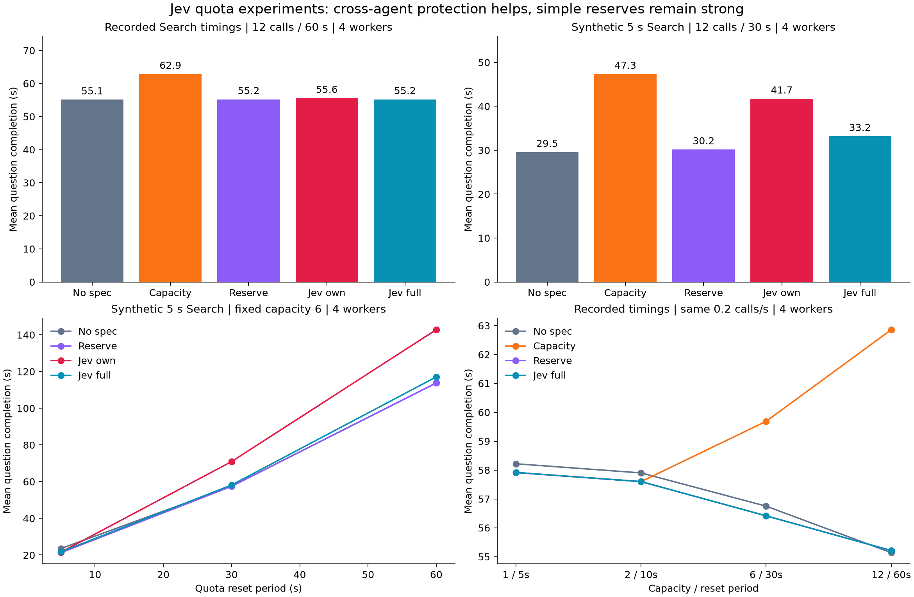

# Jev forecasting and shared-quota admission results

Jev is integrated with the complete, multi-candidate HotpotQA tapes. **Cross-agent
admission protects other agents from harmful speculation, but these experiments
do not establish a general improvement over no speculation or a tuned reserve.**
The native-timing effect is small; a separate, explicitly synthetic slow-Search
study shows substantial improvement over the own-agent ablation.



## Forecasts and implementation

- Model: requested `typesafe/jev-1.14`, returned **`typesafe/jev-1.14-20261014`**,
  provider TypeSafe through the configured OpenRouter decisions endpoint.
- **1,186 unique progress contexts**, all successful, frozen with exact inputs,
  returned probabilities, complete provider responses, model/version, token
  counts, provider-reported cost and client latency. No inference occurs in replay.
- Mean / median / p95 / maximum forecast latency: **0.296 / 0.250 / 0.535 / 0.751 s**.
  These are measured client durations, including connection, network and provider
  time, collected with four concurrent workers. They are not GPU-only times.
- Bank collection cost: **$0.030094722**; one initial Jev access probe cost
  **$0.000019950**. Total new Jev provider-reported cost: **$0.030114672**.
  Bank tokens: 716,541 input and 64,044 output. These are provider-reported
  amounts; no account-balance delta was captured for this experiment.
- Questions forecast conditional exact-candidate reuse, whether another Search
  will be required, and continuation after that next Search. Timing distributions
  come exclusively from the 20 development tapes.

`src/quota_spec/tape_forecasts.py` provides finite-context enumeration, a
phase-conditioned development history predictor, resumable collection and a
strict offline bank predictor. `src/quota_spec/forecast_study.py` connects the
existing paired-rollout admission controller to multi-candidate replay and runs
the quota sweeps. `scripts/report_forecast_study.py` derives analysis and charts.
The live actor, candidate generator and recorded trajectories were preserved.

The new finite bank covers both moments when a candidate can be judged: while
its parent Search runs and during the following actor's thinking phase. The
latter may now observe the completed parent's result. A running context never
includes that result. All demand-only phases are also covered. Contexts retain
the declared **elapsed=0 approximation**; history timing still conditions thinking
on actual elapsed time. Exact uncovered contexts stop the experiment; they are
never fetched online or silently replaced with history.

Jev receives each agent's bounded task, candidate when applicable, recent calls,
completed-step count, phase and available excerpt. The admission controller
combines forecasts for all currently active agents with the observed shared
quota/queue/execution ledger. Full versus own-only changes the gain objective;
both query the same active-agent set and retain FIFO required ordering. This
isolates the cross-agent objective from cheaper or more informative model inputs.

Per-candidate decisions assume parallel per-agent forecast requests and charge
the maximum saved response latency, plus measured scheduler time. A serial-call
ablation charges their sum. Each logical request is costed even when the exact
frozen context repeats. Thus loading a bank does not grant free inference. Started
predictions drain before a worker takes a new question; the authoritative actor
can keep progressing, and late or reset-stale admissions are discarded. Parallel
requests for different candidate ranks can overlap; there is no measured provider
concurrency limit in this simulator.

## Experiment protocol

The original capture contains 50 canonical speculative tapes and their 50
independent sequential partners. These experiments use the canonical speculative
histories only: **20 development questions and 30 exploratory evaluation
questions**, disjoint by task. This is an already explored cohort, not new
confirmatory held-out evidence. No new actor or candidate-generation calls were
needed.

Primary study: **4,000 evaluation replays** = 25 quota settings x 4 worker counts
x 5 workload-order seeds x 8 policies.

- Capacity: **1, 2, 3, 6, 12 calls per window**.
- Reset period: **1, 5, 10, 30, 60 seconds**.
- Continuous workers: **1, 2, 4, 8**, starting together and taking another question
  after all started work for the preceding question drains. One quota persists
  across the entire stream; required calls keep FIFO priority.
- Policies: no speculation, current capacity, fixed reserve, recent-usage reserve,
  history own/full and Jev own/full.
- Fixed reserve is selected from **every integer 0 through capacity**, using mean
  completion across the development questions, worker counts and first two order
  seeds. No evaluation labels select reserves. One reserve per quota setting is
  shared across worker counts.
- Paired rollout defaults: 16 samples, at most four forecast calls per chain,
  30-second horizon. No deadlines were attached, so the deadline-risk constraint
  is inactive and no deadline-risk improvement is claimed.

Additional studies: **1,284 evaluation replays**: 810 with all Search service
increased to 5 seconds, 378 native-timing latency ablations, and 96 with a
90-second rollout horizon in the slow-Search setting. The 5-second experiment
holds actor/candidate model times and outputs fixed and uses the same declared
Search duration in development timing distributions. It is a workload
sensitivity, **not measured Wikipedia behavior**. Horizon and latency followups
were selected after exploration and are reported as sensitivity checks.

Every reported replay ran with sockets blocked and checked saved answers,
quota consumption per window, worker limits/drain, and absence of predictor
fallback. Fixed recorded model durations assume unlimited model-serving
concurrency; these runs do not establish real multi-agent provider capacity.
The retained 150-second actor outlier was not trimmed.

## Recorded-timing outcome: little incremental Jev value

Example: **4 workers, 12 Search calls every 60 s**, five paired order seeds.
Values below are averages of each seed's metric; p95 is the average of within-run
p95s, not a pooled population percentile.

| Policy | Mean completion (s) | p95 (s) | Required wait (s) | Questions/s |
| --- | ---: | ---: | ---: | ---: |
| No speculation | 55.139 | 131.865 | 14.702 | 0.06941 |
| Current capacity | 62.859 | 143.471 | 17.281 | 0.06096 |
| Tuned reserve | 55.214 | 119.695 | 14.726 | 0.06932 |
| History full | 55.214 | 119.695 | 14.729 | 0.06933 |
| Jev own | 55.580 | 119.695 | 14.852 | 0.06788 |
| Jev full | 55.211 | 119.695 | 14.726 | 0.06932 |

Jev full improves mean completion **0.66% versus Jev own** here. Across the 100
primary worker/quota combinations, the largest own-to-full improvement is 0.66%.
Against the properly tuned reserve its mean changes range from **1.39% worse to
0.38% better**. This does not support a meaningful native-timing Jev win.

Jev full launches only **9 speculative Searches across its 500 primary replay
runs**. It launches zero in the example above. The capacity baseline's average
19.2 speculative calls and 14 unused calls explain much of its avoidable harm.
Suppressing harmful speculation explains the apparent 12.17% Jev improvement over
current capacity; the cheap reserve achieves essentially the same outcome.

Forecasting is often too late: with quota effectively removed and speculation
rejected on the 30 evaluation tapes, only 27 candidate ranks become available
before the next actor action. Their median remaining decision window is **0.173 s**;
17 of 27 have less than the mean Jev latency and 20 have less than its p95 latency.
Most completed candidate windows cannot help even before adding demand forecasts.
The exact policy also rejects uncertain or externally harmful opportunities.
Across the broad grid Jev does launch a few calls; it is not universally disabled.

Completion latency starts when a worker accepts a question, while throughput
includes drain and all questions. Waiting for unused generators/forecasts can
shift subsequent arrivals and quota phase. A small mean reduction versus no
speculation, without throughput improvement, must not be interpreted as useful
prefetch speedup. Example: Jev full is slightly faster in mean at 3/10 s and one
worker, but its throughput is slightly worse.

## Slow-Search sensitivity: the cross-agent objective matters

All Search service is **synthetically set to 5 s** in this section. Mean
completion, seconds; three paired workload-order seeds.

| Workers | Quota / reset | No speculation | Tuned reserve | Jev own | Jev full | Full saving vs own |
| ---: | --- | ---: | ---: | ---: | ---: | ---: |
| 4 | 6 / 5 s | 23.560 | 21.293 | 21.572 | 21.745 | -0.8% |
| 4 | 6 / 30 s | 57.444 | 57.444 | 70.918 | 58.158 | 18.0% |
| 4 | 6 / 60 s | 113.777 | 113.777 | 142.803 | 117.071 | 18.0% |
| 4 | 12 / 30 s | 29.549 | 30.153 | 41.722 | 33.188 | 20.5% |
| 8 | 12 / 60 s | 105.166 | 105.166 | 135.814 | 106.897 | 21.3% |

At **12/30 s, four workers**, full admission cuts required waiting from **6.578 to
3.454 s**, p95 completion from **103.678 to 72.880 s**, and unused speculative
calls from **43.33 to 16.67**. Its throughput improves **26.1% versus own-only**.
The paired mean saving is 8.534 s, with order-seed bootstrap interval
[7.610, 9.577] s.

However, Jev full remains **12.3% slower than no speculation** and **10.1% slower
than the tuned reserve** in that setting. History full reaches 32.991 s, slightly
better than Jev full with essentially no model cost. This supports the value of
cross-agent protection while leaving predictive admission uncompetitive with
simpler policies in this part of the workload.

Under the looser **6/5 s** quota, Jev full beats no speculation by **7.7%** in mean
and 2.3% in throughput, but current capacity is faster still at 21.064 s. There
is little externality to predict when quota refills quickly enough.

The bootstrap resamples only 3 or 5 order-seed means from the **same fixed 30
questions**. It measures order sensitivity conditional on this bank, not
population uncertainty or independent model trials. The full paired values,
seed ranges and interval warning are saved in `results/jev-study-analysis/analysis.json`.

## Reset length is not equivalent to nominal calls per second

At four workers with recorded Search timings, each setting below permits the
same **0.2 calls/s** over long periods, but speculation behaves differently.

| Capacity / reset | No speculation mean (s) | Current capacity mean (s) | Jev full mean (s) |
| --- | ---: | ---: | ---: |
| 1 / 5 s | 58.217 | 57.915 | 57.915 |
| 2 / 10 s | 57.901 | 57.599 | 57.599 |
| 6 / 30 s | 56.749 | 59.687 | 56.413 |
| 12 / 60 s | 55.139 | 62.859 | 55.211 |

Large, infrequent resets expose more spare slots early in a window. Greedy
speculation can consume those slots and delay later required calls. This bank's
capacity baseline worsens as windows grow, even though the nominal rate is fixed.
Required-only behavior also changes because larger batches service bursts
differently; the result is not explained by average rate alone.

The 90-second horizon check reduces Jev full's slow-Search mean at 12/30 s and
four workers from 33.188 to **30.764 s**; own-only is 39.696 s. This is a 22.5%
full-versus-own saving, but it still loses to no speculation (29.549 s) and the
reserve (30.153 s). A 30-second horizon can miss harms beyond long resets;
this sensitivity matters before tuning a controller.

## Prediction quality and overhead

On evaluation contexts, conditional reuse is much less calibrated than demand:

| Forecast target | Context count | Jev Brier | History Brier | Jev ECE | History ECE |
| --- | ---: | ---: | ---: | ---: | ---: |
| Exact reuse, conditional on another Search | 218 | 0.2421 | 0.1430 | 0.3421 | 0.0740 |
| Another Search before finish | 674 | 0.1633 | 0.1838 | 0.0639 | 0.0763 |
| Continuation, conditional on another Search | 449 | 0.2466 | 0.2432 | 0.0968 | 0.1309 |

These are finite-context diagnostics, including contexts never reached during
admission. They are not weighted by online decision frequency. Jev is better
on whether another Search is needed, but worse on the exact-match reuse that
makes prefetching worthwhile. No post-evaluation calibration was fitted.

At 12/30 s, four workers and synthetic 5-second Search, a 30-question Jev-full
replay makes an average 414 logical forecast requests, representing **$0.009890**
at the measured per-context costs. Its summed decision overhead is 40.638 s;
that is distributed overlapping work, not 40.638 s added to every question.
History full uses about 0.108 s of summed decision time.

Serial forecasts reduce speculative opportunities and can look faster by
accidentally suppressing harmful launches: serial Jev full reaches 29.922 s
there, versus 33.188 s for parallel. Artificially removing forecast latency gives
34.679 s, worse than measured-latency full because it admits more harmful calls.
**Faster prediction alone is insufficient; forecast calibration and the gain
objective also need to improve.** The zero-latency rows are counterfactual, not
measured Jev serving performance.

Scheduler decision time is measured per replay with a 1 ms floor. Native primary
mean/p95/max measured decision wall time is 0.774/1.734/21.197 ms. CPU scheduling
noise can change borderline admissions in reruns; exact reported rows are saved.
One-agent own/full controls have identical speculative-call counts in every
primary and slow-Search paired seed. No deadline or per-worker fairness superiority
is claimed; per-question waiting and Jain completion metrics remain in raw rows.

## Validation, retained evidence and next work

**180 tests pass; Ruff lint and formatting pass.** New tests exercise observed
result visibility, phase coverage, development-only timings, HTTP/SSE adapters,
exact-context failure, checksums, resumable collection, bounded failure stopping,
parallel/serial charges, socket-blocked replay and the one-agent control.
All 14,815 prior capture/data evidence files are checksum-verified unchanged.

Per your follow-up, further work uses **Jev only**. The optional Kev adapter and
two successful three-question public-demo responses are retained as an access
check, not a Kev evaluation bank. Subsequent requests hit the public ZeroGPU
runs limit; no bypass or substitute model was used. Loaded weight revision and
billing are unverified. One earlier single-question Kev probe's original full
response was overwritten during access diagnosis; its console-recovered summary
is explicitly identified, and it contributes no scheduling result.

Next research work should improve exact-match candidate reuse and prediction
lead time, calibrate using development data, then test a reserve-plus-prediction
rule against the complete reserve range on a **new** question cohort. A small
live multi-agent check remains necessary before claims about real contention.
More sweep points on the same 30 questions will not provide fresh confirmation.

Authoritative artifacts:

- `results/hotpot-jev-progress-50/`: complete bank and all 1,186 collection attempts.
- `results/hotpot-forecast-quota-native-full-reserves/`: final 4,000-run native study.
- `results/hotpot-forecast-quota-slow-search-full-reserves/`: final 810-run sensitivity.
- `results/hotpot-forecast-quota-native-latency-final/`: 378 native latency ablations.
- `results/hotpot-forecast-quota-horizon90/`: 96 longer-horizon sensitivity runs.
- `results/jev-study-analysis/analysis.json`: derived comparisons and history calibration.

Earlier directories without `full-reserves` retained an initial reserve search
capped at four slots; **they are superseded and excluded from the reported
comparisons**. `hotpot-forecast-quota-native-latency/` is a failed setup attempt
with no rows, caused by integer/float reset-key formatting; the final suffixed
study fixes it. Original attempts are retained rather than silently overwritten.

Results and banks are Git-ignored. `docs/JEV_STUDY_MANIFEST.json` identifies a
credential-free local bundle; keep it separately from an ordinary checkout.

## Reproduction

No-network analysis of the retained bank:

```sh
.venv/bin/python -m quota_spec.forecast_study results/hotpot-dataset-50 \
  --bank results/hotpot-jev-progress-50/bank.json \
  --output results/forecast-native-new
.venv/bin/python -m quota_spec.forecast_study results/hotpot-dataset-50 \
  --bank results/hotpot-jev-progress-50/bank.json \
  --output results/forecast-slow-new \
  --capacities 2 6 12 --windows 5 30 60 --agents 1 4 8 \
  --seeds 248 249 250 --tool-duration-s 5 \
  --policies no_speculation current_capacity fixed_reserve usage_reserve \
    history_own history_full jev_own jev_full jev_zero_latency_full jev_serial_full
.venv/bin/python scripts/report_forecast_study.py
.venv/bin/python -m unittest discover -s tests -q
.venv/bin/ruff check src tests scripts
.venv/bin/ruff format --check src tests scripts
```

Fresh forecast collection explicitly makes paid calls; use only when changing
coverage, model or question wording, and preserve the existing bank:

```sh
set -a
source .env
set +a
.venv/bin/python -m quota_spec.tape_forecasts results/hotpot-dataset-50 \
  --backend jev --workers 4 --max-requests 2000 \
  --output results/forecast-bank-new
```

Access contract checked against [TypeSafe System One documentation](https://docs.typesafe.ai/api/system-one).
The optional demo route follows the [Kev upstream implementation](https://github.com/jaredpalmer/kev/blob/main/space/app.py).
