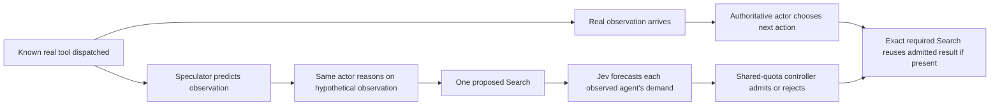

> Preserved reference/extension documentation. The active concurrent baseline and
> current work order are [README](../README.md) and [next_steps.md](../next_steps.md).

# Canonical paper workload with cross-agent quota admission

**Baseline prerequisite:** current work is the single-agent reproduction in
[SINGLE_AGENT_REPRODUCTION.md](SINGLE_AGENT_REPRODUCTION.md). Do not treat this
extension's neutral replay pilot as a reproduced paper baseline. The standalone
`quota_spec.paper` entry point now shares the tested state-isolated collector,
reports Figure 4 agreement correctly, and never calls Jev or admission policies.

Use `python -m quota_spec.paper_pipeline` for the current experiment. It connects
the authors' HotpotQA/ReAct/Wikipedia workload to our shared-quota scheduling
study. The direct-query/local-BM25 pipeline is retained for legacy fixtures and
must not supply data to the canonical experiment.

The research comparison is system-wide admission versus the same rule considering
only the proposing agent's gain. Jev supplies probabilities; our controller makes
the admission decision. This approximates a global objective over a bounded
forecast horizon and does not guarantee a global optimum.

## What the command does

1. Fetch/verify the pinned upstream source, dataset and six-shot prompts. Collect
   the original seeded HotpotQA questions using the original ReAct actor, live
   Wikipedia Search, stateful Lookup and Finish. Models default to Gemini 2.5
   Flash in both roles, a pairing evaluated by the paper.
2. Generate predicted tool observations and run the same actor on those
   hypothetical branches to propose the next action. Fix width to **one**,
   corresponding to the paper's single-candidate condition. If the prediction is
   Lookup or Finish, record it without submitting a search-quota candidate.
3. Preserve raw authoritative/hypothetical branches. Normalize every actual
   ReAct step, keeping each actor latency, tool duration and result excerpt.
   Only Search uses quota and exact reuse. Lookup/Finish stay local and uncached.
   Wrong-candidate Search duration is measured in an isolated post-episode tool
   benchmark, whose result is never sent to an agent or predictor.
4. Split the selected question order into development/evaluation halves. Learn
   timing distributions and tune reserve/horizon/overhead on development only.
   Freeze each selected Jev/mock context bank once on held-out observed states.
5. Run all policies on identical dependency-aware traces and candidates for
   1/2/4/8-agent batches, quota/load settings and repeated seeds. Both full and
   own-agent admission use the same forecast bank and sampling seed. Only the
   summed gain objective differs; the global deadline-risk guard is unchanged.

The primary pair is `jev_progress_full` versus `jev_progress_own` (or another
fixed context). Other controls include no speculation, current-capacity admission,
fixed reserve, usage forecast, history full/own and separate required-ordering
controls. Fixed candidate proposals prevent a policy from improving simply by
receiving better guesses. The current production selection deliberately omits Kev.

## Timing and information boundaries

The collector runs real and hypothetical branches serially to measure them.
Its script wall time is **not** the experimental completion time. Replay models
the dependency overlap:



Each candidate's release time is the preceding required tool's **dispatch** plus
its observation prediction and speculative-actor latency. Quota waiting delays
that dispatch and therefore delays the proposal. Reuse/join can shift later
dependencies. Required actions never wait for optional inference, and tied/late
proposals cannot jump ahead of required readiness.

Hypothetical text stays branch-local. The real actor always receives true tool
observations. Forecasts receive only arrived agents' observed task/progress,
recent tool history and bounded completed-result excerpts. Pending tool responses
and held-out labels never enter online inputs. Pending-owner bank cases use the
next candidate without exposing the current unfinished response.

The upstream reset-index/state-isolation fixes remain in force. Canonical
collection additionally simulates a pending local tool from its **pre-tool**
snapshot, and records its returned observation (avoiding a stale prior Search
prediction for Lookup). It clamps the actor's action list to the requested width.
Original source files stay pristine; adapters/configuration record the protocol.

The paper's agreement metric case-folds actions. Quota reuse is stricter: the
same tool and exact canonical argument bytes are required. No semantic or
case-insensitive cache substitution is introduced. The single-candidate study
must not be compared directly with the paper's top-three agreement headline.

## Run without model access

```sh
.venv/bin/python -m pip install -e '.[paper,analysis,dev]'
.venv/bin/python -m quota_spec.paper --prepare-only
.venv/bin/python -m quota_spec.paper_pipeline \
  --backend mock --count 8 --predictors mock \
  --contexts task history progress no_history no_progress \
  --seeds 7 17 --samples 4 --window-s .1 --no-plots \
  --output results/paper-offline-next
```

Preparation downloads public pinned source/data once. After preparation the mock
pipeline works with socket connections blocked and no credentials. Mock model
and Wikipedia transports exercise the original prompts, parser and environment;
their predictions and answer scores are synthetic fixtures, not scientific evidence.

## Bounded actual-model smoke test for the next agent

```sh
set -a
source .env
set +a
.venv/bin/python -m quota_spec.paper_pipeline \
  --backend http --actor google/gemini-2.5-flash \
  --speculator google/gemini-2.5-flash --count 4 \
  --predictors history jev --contexts progress --seeds 7 17 \
  --samples 4 --window-s 10 --max-requests 128 \
  --max-forecast-requests 200 --no-plots \
  --output results/paper-paid-smoke-next
```

`OPENROUTER_API_KEY` supplies actor/Speculator access. Jev still uses
`TYPESAFE_API_KEY`, `JEV_BASE_URL=https://openrouter.ai/api/alpha` and
`JEV_MODEL=typesafe/jev-1.14`; `.env` already supports those settings. Keys never
enter configurations. The main canonical transport uses the pinned upstream
OpenRouter parameters (1000 actor output tokens and 100 observation-model tokens),
not legacy `QA_*`/`SPECULATOR_*` reasoning/JSON flags. Check truncation/model
compatibility before interpreting a model change. Never silently increase a
reasoning budget while claiming an unchanged baseline.

Four questions mean only two held-out questions: this checks integration, not
four/eight-agent performance. `runs.json` reports both requested `agents` and
actual `max_active_agents`. Use the original 20-question sample for at least one
full eight-agent held-out batch, subject to the remaining API budget and review.
Do not assume 20 tasks form a representative HotpotQA evaluation.

Choose a fresh directory for new configurations. `--resume` requires unchanged
source/configuration and reuses successful tasks and forecast responses. Actual
inference logs retain failed attempts. Request budgets include retained inference
on collection resume. An interrupted partial study is preserved and requires a
fresh study/output path; it is not overwritten automatically.

## Artifacts and validation scope

- `pipeline_config.json`, `status.json`: source identity, model choices and stages.
- `traces/tasks/*.json`: raw true/predicted branches, model timings, candidate
  benchmarks, normalized mixed-action traces, split and post-task answer scores.
- `traces/inference.jsonl`: all actual actor/Speculator attempts, separately tagged.
- `traces/environment.json`: pinned upstream environment and observation hashes.
- `traces/development.json`, `evaluation.json`: frozen, disjoint normalized traces.
- `forecasts/`: immutable probabilities, latency/cost telemetry and calibration.
- `study/`: frozen development tuning, events, per-agent outcomes, paired intervals.
- `qa_outcomes.json`, `inference_summary.json`, `REPORT.md`: quality/cost and results.

Current verification consists of local unit/integration tests and a mock study.
No new paid experiment was run during this refactor. The canonical controller
integration is currently a **frozen replay experiment**. The legacy live HTTP
gateway is not yet an independent end-to-end live ReAct/Wikipedia validation.
The next agent should inspect replay fidelity before making a live speedup claim.
The ready-to-use handoff is [NEXT_AGENT_TESTING_PROMPT.md](NEXT_AGENT_TESTING_PROMPT.md).
