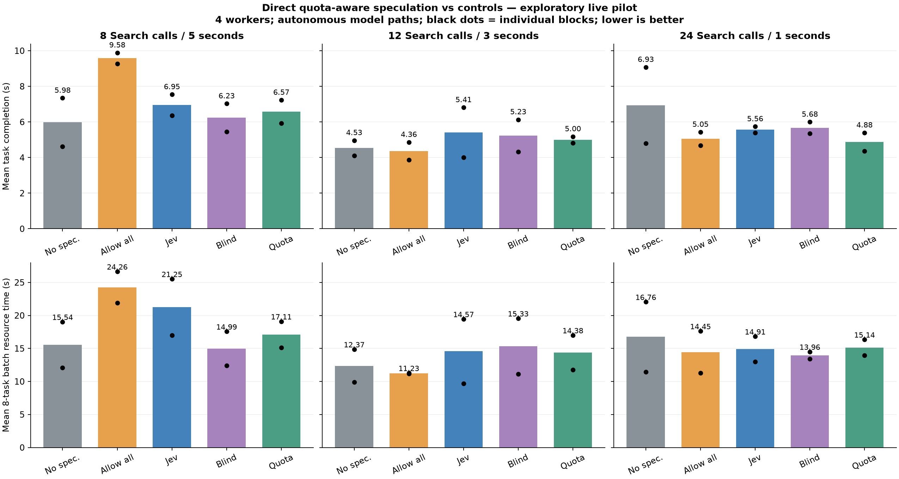

# Direct quota-aware speculation, November 15, 2026

The previous integration and 80-question replay result were committed and pushed
as `2deb6f5` before this experiment. The new optional planner receives current
shared Search quota directly and replaces Jev admission with its own decision
about which searches to propose. The authoritative main agent receives its
original prompt and real observations only.

## Implementation

Use `--policy current_capacity --speculation-planner quota`. The hypothetical
Gemini speculative actor receives the same predicted-observation trajectory,
plus observed capacity, remaining calls, refill period/time to reset, active
workers, queued required calls and recent required activity. It returns zero to
three exact Search queries. No Jev calls or key are required in this mode.
The observation predictor remains GPT-4.1 nano. The actual Gemini actor receives
no quota context, planner instructions or schema change.

The final prompt asks the planner to leave calls for queued work and one next
Search per other active worker when refill is more than one second away. This
is an explicit conservative planning instruction, not a learned forecast.
Required FIFO and atomic quota enforcement still apply to every proposal;
model advice cannot reserve calls or override waiting required work. Snapshots
can become stale during inference and dispatch rechecks available capacity.

Structured output is restricted to the speculative branch, using OpenRouter's
[documented JSON Schema format](https://openrouter.ai/docs/guides/features/structured-outputs).
Unsupported legacy zero penalties are omitted only for those schema requests.
The local parser validates queries, removes exact duplicates and enforces the
same bounded top-k behavior as the original generator. Empty lists are valid
abstentions. Every started model request and background operation is charged.

Tests compare deterministic main-agent prompts byte for byte with the baseline,
check that only speculative requests carry the schema, and reject fabricated
remaining-quota observations during an independent audit.

## Development probes and retained failures

Raw quota facts with a generic request to conserve calls were insufficient.
On 16 paired development contexts, mean proposed queries were 1.625 with
abundant quota and 1.4375 with scarce quota (one malformed-width output counted
as a skipped proposal). Both states yielded only one skip. The revised explicit
reserve instruction yielded 1.8125 and 0.25 queries respectively, with **14/16
scarce-state skips versus 1/16 abundant-state skips** and zero invalid outputs.
These use artificial scheduler states and are behavior probes, not speed tests.
They use only the original development questions.

All initial attempts remain under `results/quota-prompt-2026-11-15-*`:

- `live-pilot`: soft JSON formatting failures, then a public Wikipedia 429.
- `schema-pilot`: strict routing rejected unsupported legacy penalties; repeated
  unknown-cost reservations exhausted the protective budget and stopped the run.
- `clean-pilot`: the generic quota prompt was not a consistent improvement;
  a four-query response stopped the strict-width implementation. All actor
  outcomes and failed proposals are retained.
- `reserve-pilot`: revised explicit reserve instruction, schema limit and bounded
  top-k parser; a fresh, separately recorded set of 16 questions.

No failed run was relabeled as a successful confirmation or silently discarded.

## Comparative live pilot

The final study uses four workers and the same 16 new questions across three
quota regimes: 12 calls / 3 seconds, 8 / 5, and 24 / 1. Each setting has two
8-question blocks and five randomly ordered policies: no speculation,
allow-all, the frozen calibrated pooled Jev method, the direct planner without
quota context, and the direct planner with quota context. Direct planners use
identical instructions, models and schemas; supplied quota data is the ablation.
Jev and direct planners use the development-selected step-4 generation budget;
allow-all retains unrestricted generation as in the earlier benchmark.

There is a 45-second recovery pause between runs, outside batch timing. The
study records autonomous stochastic model paths and native provider latencies;
it is not matched-path replay and does not inherit the earlier result's
statistical strength. Provider variation, different action paths and only two
blocks per setting limit conclusions. Report accuracy and unused calls with
completion time. Do not select a new default using this small pilot alone.

| Calls / refill | No speculation | Allow-all | Jev | Blind planner | Quota planner |
| --- | ---: | ---: | ---: | ---: | ---: |
| 12 / 3s | 4.533 | 4.363 | 5.408 | 5.225 | 5.001 |
| 8 / 5s | 5.978 | 9.577 | 6.951 | 6.233 | 6.573 |
| 24 / 1s | 6.932 | 5.050 | 5.560 | 5.676 | 4.880 |

Mean task completion in seconds. Every entry has 16 tasks in two 8-task blocks.

| Calls / refill | No-spec batch (s) | Allow-all batch (s) | Quota batch (s) | Quota unused / allow-all unused |
| --- | ---: | ---: | ---: | ---: |
| 12 / 3s | 12.374 | 11.226 | 14.382 | 19 / 30 |
| 8 / 5s | 15.541 | 24.261 | 17.108 | 9 / 38 |
| 24 / 1s | 16.756 | 14.450 | 15.135 | 16 / 42 |

Batch times average the two complete 8-task runs and include all background work.

| Calls / refill | No-spec correct | Allow-all correct | Jev correct | Blind correct | Quota correct |
| --- | ---: | ---: | ---: | ---: | ---: |
| 12 / 3s | 6/16 | 7/16 | 7/16 | 6/16 | 6/16 |
| 8 / 5s | 7/16 | 6/16 | 8/16 | 7/16 | 7/16 |
| 24 / 1s | 6/16 | 6/16 | 7/16 | 6/16 | 5/16 |

The new mode does **not establish a win over both baselines**. At 12/3 it
is slower than both. At 8/5 it reduces mean completion by 31.36% versus allow-all,
but is 9.96% slower than no speculation. At 24/1 its observed mean is 3.37% below
allow-all and 29.61% below no speculation, but its batch time is worse than
allow-all and it answers one fewer question correctly. The descriptive paired
question-bootstrap interval versus allow-all at 24/1 spans zero
([-0.797, 1.211] seconds saved). Questions also share workers; with only two
blocks, that interval is not a reliable estimate of live policy uncertainty.

Only 4–8 of 16 action paths match the quota planner's paths in most comparisons.
One wide-quota no-speculation Finish call alone took 15.95 seconds; no tail was
trimmed. The initial quota phase is anchored to capture startup, so setup time
can also shift the first refill relative to task dispatch. Future confirmation
should align that phase and use common actor randomness or a matched dynamic
planner replay. Current observations must not be presented as causal speedups.

The useful result is resource awareness: under 8/5, the planner skipped 26/37
plans, compared with 3/27 at 12/3. Across the three regimes it left 44 unused
prefetches versus allow-all's 110. It still exceeded the prompt's suggested
headroom on 9/64 plans at 8/5 and 12/3; model instructions are not reservations.
The scheduler independently enforced the actual quota and required priority.
Jev remains the default; the direct mode is an explicit experiment.



[Aggregate metrics and descriptive intervals](evidence/quota-prompt-2026-11-15/report.json)
· [Locked pilot order/configuration](evidence/quota-prompt-2026-11-15/protocol.json)

## Cheap controller ablation

A separate exploratory replay applies the same one-call-per-other-worker reserve
rule directly, without a Jev forecast or additional model gate. It keeps the
old saved quota-unaware candidates and charges saved generation service, so it
does **not** measure the quota-aware language planner above. On the previously
explored 80-question bank at 12/3, mean time is 6.10071 seconds versus 6.16362 for
no speculation and 6.74907 for allow-all (about 1.02% / 9.61% reductions).
Whole-batch time is 125.63091 versus 126.70459 / 138.87022. At 8/5 this rule loses
to no speculation; at 24/1 its mean essentially ties allow-all. These 90
network-blocked replays are a control, not a new held-out confirmation or proof
of the language model's quota reasoning. See [the control data](evidence/quota-prompt-2026-11-15/headroom-ablation.json).


## Reproduction

```sh
.venv/bin/python -m quota_spec.multi_agent \
  --backend http --policy current_capacity --speculation-planner quota \
  --agents 4 --count 8 --offset 306 --capacity 12 --window-s 3 \
  --generation-step-budget 4 --samples 32 \
  --max-usd .15 --forecast-max-usd .025 \
  --output results/quota-aware-fresh
```

This spends API credit. `--speculation-planner blind` removes only the supplied
quota context. `legacy` retains the existing generator, and Jev remains available
as `--policy jev_full`. The pilot controller is
`scripts/run_quota_prompt_pilot.py`; choose a fresh output directory and unused
question offsets. A `STOP` file in that output directory stops between runs.

## Verification and cost

All 30 final runs independently pass capture/context/quota/FIFO audits: **240
clean live episodes**, zero final actor or optional failures, and zero Jev
requests in quota/blind modes. Across development and failed attempts, **380
paid live episodes** are retained, including three failed actor episodes.
Historical planner prompts are audited against their hash-checked frozen source,
so evolving the prompt does not invalidate earlier negative evidence.

**281 tests pass.** The campaign retains 3,713 model API-attempt records and verifies
2,891 frozen source files. Known charges total **$1.256674044**, matching the
settled account delta. Fifteen failed attempts retain unknown individual costs;
their conservative reservations add $0.1028643, making the recorded upper bound
$1.359538344. The final 240-episode pilot has $0.721175218 in known charges.
No failed attempt, uncertainty or reservation was silently assigned zero cost.
[Itemized cost and source audit](evidence/quota-prompt-2026-11-15/campaign-audit.json).

Full model responses, stage captures, per-question outcomes and executed source
snapshots remain in the ignored local `results/quota-prompt-2026-11-15-*`
directories. Compact aggregate evidence is committed with this report.
