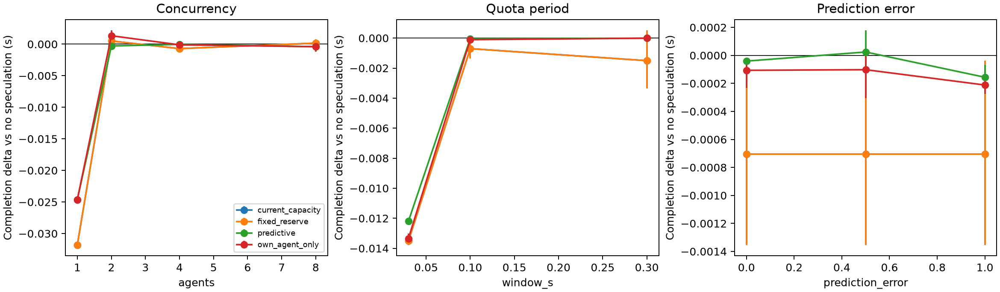

# Predictive Scheduling Under Shared API Quotas: exploratory report

> Review note (October 28, 2026): numerical results below are historical, from
> before the correctness review. Current code fixes progress tracking, forecast
> state, execution-duration leakage, deadline censoring, inference overhead and
> aggregation. Regenerate studies before using old numbers as current evidence.
> See [API setup](API_SETUP.md) and [review validation](REVIEW_VALIDATION.md).

Recorded October 28, 2026. This is a measured engineering report for the local
prototype, not the proposal's final eight-page research submission. Source data,
settings and numeric summaries are retained in [evaluation-summary.json](evaluation-summary.json).

## Research question and implementation

Can an optional search's expected latency saving justify the quota delay it
creates for other agents, including required work not yet submitted? The system
compares paired sampled futures under a shared aligned fixed-window quota.
Completion and cancellation do not refund allowance. Exact task/tool/argument
matches reuse a completed result or join a running execution.

The implementation includes deterministic dependency-aware replay, quota
baselines, a development-trained history table, bounded cross-agent admission,
an own-agent gain ablation, separate progress-aware required scheduling, and
an atomic asyncio/FastAPI gateway. A privileged greedy reference uses known
future traces only for diagnostics. Jev/Kev contract adapters are implemented;
real external inference has not been run.

## Dataset and information boundary

The frozen workload contains 200 actual local scripted retrieval trajectories
from the first 200 HotpotQA distractor validation examples. A shared BM25 corpus
contains 1,991 documents. A deterministic original-ID hash splits tasks 100/100
into development and evaluation, and the pilot uses 20 development tasks.
[HotpotQA](https://hotpotqa.github.io/) and its derived subset retain the
[CC BY-SA 4.0 attribution](../data/README.md).

Each task performs three searches. The required-query heuristic and the one-call
candidate generator use only question text and previous returned documents.
Gold answers/support titles are isolated in the evaluator. Recorded think and
service timings include controlled 15 ms and 10 ms delays, respectively. These
are scripted retrieval agents; no LLM generated a final answer. A mismatched
candidate currently uses the required call's latency estimate in replay.

The online policy sees only arrived active agents, observed phase/progress,
deadlines, bounded prior excerpts/history, the ledger, required queue and registry.
Future arrivals, hidden calls and trace durations remain in the simulator.
The history table is fitted only on development tasks. Predicted next-call
identities are hypothetical except for sampled candidate reuse.

## Frozen design

The development-selected reserve is 0; therefore tuned reserve and
current-capacity admission coincide in this run. Development selected a
0.3 s horizon. The rule uses eight shared scenarios, at most four
predicted calls per active agent, epsilon .05, and a frozen
3 ms decision cost. This cost rounds up a development p95 measurement
of 2.012 ms; actual decision wall times are logged separately.

The objective sums projected completion savings across agents, with endpoints
censored at the horizon. The risk guard counts newly introduced deadline misses
per observed deadline within the horizon. The own-agent ablation changes the gain
objective only, keeping the same predictor, seed and global risk guard. Predictions
can be wrong; the risk estimate does not guarantee realized deadlines.

Twelve focused sensitivity settings cover 1/2/4/8 agents, capacity 1/2/3/6,
window .03/.1/.3 seconds, burst/staggered arrivals, and reuse-probability
inversion error 0/.5/1. The design varies one factor around the base setting.
Each repeated seed processes all 100 evaluation tasks in independent batches
of at most N agents, with quota reset between batches. Deadlines are four
windows after task arrival. Seven policies/controls and five seeds yield
420 aggregate run rows and 42,000 task-policy outcomes.

## Held-out replay results

The table reports mean completion differences from no speculation, in
milliseconds, at quota three per .1 s with burst arrivals and unperturbed history.
Negative values are faster. Predictive intervals are 95% percentile bootstrap
intervals over the five paired whole-seed aggregates, preserving within-run
shared-quota interference.

| Agents | Current capacity delta (ms) | Predictive delta (ms) | Predictive 95% interval (ms) | Own-agent delta (ms) |
| --- | ---: | ---: | --- | ---: |
| 1 | -31.809 | -24.622 | [-24.986, -24.308] | -24.622 |
| 2 | +0.504 | -0.282 | [-0.467, -0.070] | +1.331 |
| 4 | -0.704 | -0.041 | [-0.062, -0.019] | -0.106 |
| 8 | +0.157 | -0.400 | [-1.200, +0.000] | -0.400 |

The one-agent control benefits from early search/reuse, but its predictive rule
is slower than current-capacity admission after overhead and forecast error.
At two agents, accounting for other agents avoids some harm seen in the
owner-only variant. At four/eight agents, absolute admission differences are
small compared with quota-window timing; estimates vary across regimes. This
workload does not establish that predictive admission consistently beats simple
reserves. A negative or inconclusive result remains useful evidence about when
the extra complexity is justified.

The history predictor's held-out candidate-reuse Brier score is
0.0682, with ECE 0.0410 over
300 candidate labels. This reflects three fixed scripted stages rather
than broad semantic prediction quality. No Jev/Kev calibration is available.

The complete settings, p95 metrics, deadline misses, unused speculation and
positive-delta regressions are in `evaluation-summary.json` and raw study
artifacts. The progress-ordering control changes required scheduling and must
not be interpreted as an admission-rule improvement. Current-capacity and the
zero-reserve tuned baseline overlap in the figure.

## Pilot and privileged reference

For the 20-task development pilot launched together with quota three per .1 s,
no speculation averaged 1.573951 s and the greedy future-informed
reference averaged 1.568951 s. This privileged diagnostic shows
limited available gain under strong contention. Synthetic regression cases also
cover useful single-agent admission, cross-agent harm that the reference rejects,
and contention with no meaningful mean improvement. The reference is not a
global optimum or a deployable predictor.

## Live correctness and timing

Twelve development-pilot scripted agents were run through the real asyncio
gateway, with concurrency capped at four and quota three per .1 s. The table
compares measured live completion with replay using recorded timing estimates
and observed task arrival times. Live runtime includes scheduling, search and
thread dispatch effects.

| Policy | Live mean (ms) | Replay mean (ms) | Dispatches |
| --- | ---: | ---: | ---: |
| no_speculation | 340.26 | 324.46 | 35 |
| current_capacity | 342.40 | 337.25 | 35 |
| fixed_reserve | 342.59 | 329.57 | 35 |

All required query sequences and full result contents matched the no-speculation
baseline exactly across the three policies. Every fixed window respected quota.
Supporting-title recall averaged 0.708.
This measures retrieval coverage, not generated-answer correctness; answer exact
match remains null. These timings are a single live check, not a randomized live
policy performance study. Python scheduling, measured tool jitter, and replay's
conservative overhead reservation convention limit timing fidelity.

## Validation and external dependencies

The suite has 41 passing tests covering fractional quota boundaries, serial
readiness, exact cache/in-flight joins, atomic duplicates, failed speculation,
cancellation without refund, FIFO refill ties, no future snapshots, bounded
forecast contracts/timeouts, deadline risk, cross-agent harm, prediction error,
checksummed corpus loading and disjoint data splits. Editable package install
and CLI invocation were also validated.
Repeating the complete study with its saved frozen configuration reproduced all
420 aggregate rows, paired comparison intervals and calibration outputs exactly.

No Jev credential is configured, and no Kev runtime/endpoint is installed.
The selected Kev-0.8b v1.0 artifact has a resolved public revision, recorded in
[the model audit](MODEL_ACCESS.md). The local machine has 8 GiB RAM and limited
remaining disk space. External inference latency, cost, token use and calibration
remain unmeasured. Mock responses verify contracts only. There is no inference
training and no paid API use in the recorded experiments.

## Limits and next evidence

The first-200 source subset, three-step scripted retrieval, shared distractor
corpus, controlled service delays, batch quota resets, five seeds and finite
horizon restrict generalization. Bootstrap intervals condition on this workload
and quantify ordering/sampling variation rather than population uncertainty.
Unknown arrivals, inference latency tails, failures/retries in replay, general
DAGs, semantic matching and multiple gateway processes are not modeled.

Next collect real main-model QA trajectories and answers, enable Jev and a
pinned pretrained Kev server, run the implemented context ablations, measure
all inference/candidate costs, and repeat held-out comparisons with a broader
workload. Finalize the eight-page report after those measurements, including
negative regimes and timing mismatches.

## Reproduce

Follow the [README](../README.md) for setup. Run the test suite, then
`python -m quota_spec.experiments` and `python -m quota_spec.live` with `src` on
PYTHONPATH. Existing frozen input traces avoid network/model dependencies. Use
`--frozen-config results/study/frozen_config.json` and a fresh output directory
to reuse the reported admission settings, seeds and modeled overhead. Preserve
config, source hashes, input/corpus hashes, outcomes and event logs. Recollecting
tool timings is a new experiment and will not exactly reproduce the saved run.
