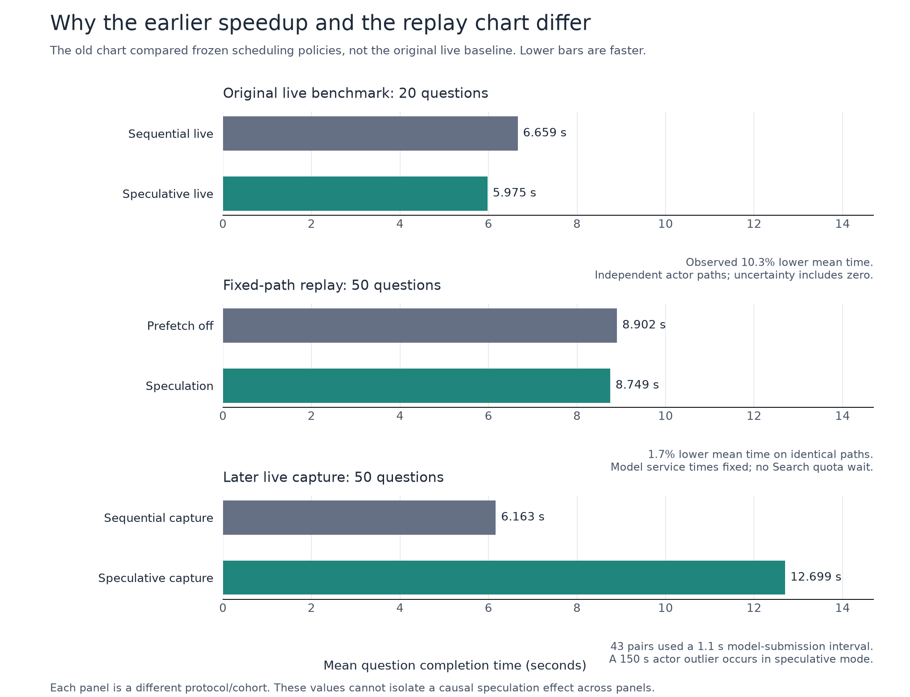

# Why the speculation chart did not match the earlier speedup

**The chart mixed the interpretation of different comparisons.** Its baseline
was a counterfactual on the newer speculative actor paths, not the earlier live
sequential execution. The later capture also used a different model-submission
regime. I corrected the labels, added an actual nonbinding-quota control, and
checked the scheduler with an independent timing calculation.

The original observed improvement remains in the evidence. The newer graph does
not reproduce that experiment, and should not have been presented as if it did.
The audit found no missing overlap/cache-hit logic in the unlimited-quota replay
comparison checked here. It does not establish live provider-capacity fidelity.



## 1. The original result and the plotted result were different experiments

| Comparison | Questions | Baseline mean | Speculative mean | Mean saving | What is held fixed? |
| --- | ---: | ---: | ---: | ---: | --- |
| Original live benchmark | 20 | 6.659 s | 5.975 s | 10.27% observed | Same questions; independent actor outputs and measured service times |
| New capture's canonical paths, no-quota replay | 50 | 8.902 s | 8.749 s | 1.71% modeled | Identical actor actions, outputs and service times |
| Development subset of that replay | 20 | 6.440 s | 6.275 s | 2.56% modeled | Identical canonical paths and service times |
| Evaluation subset, no-quota replay | 30 | 10.543 s | 10.399 s | 1.37% modeled | Identical canonical paths and service times |

The old chart's "No speculation" bar meant: take an authoritative trajectory
collected in speculative mode and execute its saved model/tool service durations
without prefetching. That is a valid scheduling counterfactual, but it is **not
one of the independently measured sequential episodes**. The graph used only the
30-question evaluation subset, four workers and a shared Search quota, further
separating it from the original 20-question one-agent live experiment.

A 150.150-second actor call in the newer evaluation paths increases both fixed-
path bars equally in the unconstrained comparison. It is retained, not clipped.
This explains much of the difference in absolute averages from the earlier run;
it is not an extra speculation wait imposed by the replay engine.

## 2. Later capture changed model submission pacing

The original live benchmark did not impose a local model-submission interval.
Seven later capture pairs were also unpaced. The other **43 pairs used one shared
1.1-second minimum interval** for authoritative actors, observation prediction and
hypothetical actors. This was introduced to collect complete data without
repeated provider-rate-limit failures.

It means optional requests can delay when a true actor request is submitted.
This is a capture-harness/model-admission effect, separate from the simulated
Search quota. The frozen scheduling study intentionally removes local collection
queues and reuses model service durations; its wall times cannot reproduce the
paced live wall times by construction.

Across the later 50 actual live pairs:

| Measured component, total seconds | Sequential | Speculative |
| --- | ---: | ---: |
| Authoritative model HTTP/provider service | 180.796 | 331.037 |
| Authoritative local submission/semaphore queue | 16.555 | 190.659 |
| Required tool wait | 108.566 | 110.813 |
| Other elapsed work | 2.256 | 2.466 |
| Total answer wall time | 308.173 | 634.975 |
| Mean answer wall time | 6.163 | 12.699 |

The actor-service difference is about 150.241 s, nearly all accounted for by the
single recorded 150.150 s actor call in speculative mode. Local actor queueing
adds another **174.104 s** of difference. Together those two measured components
explain about **99.25%** of the later capture's wall-time gap. This is an elapsed-
time reconciliation, not a causal isolation of provider variability.

The later capture is therefore useful as a complete saved-output bank, but its
raw wall times are **not a replication of the original unpaced live speed test**.
The original capture report established completeness/state validity, not a new
speedup. Treating the full capture as unchanged benchmark evidence was incorrect.

New runtime configurations and summaries now explicitly identify whether model
submission is paced, its interval, and whether required/optional requests share
that pacing. Legacy saved summaries still regenerate exactly, without rewriting
old evidence. This adds reporting metadata; it does not change request priority,
pacing, model settings, outputs or paid behavior.

## 3. The original 10.27% advantage was not an isolated prefetch effect

The original 20-question live comparison saved **13.684 total answer seconds**.
Its timing records reconcile as:

| Observed difference | Seconds favoring speculation |
| --- | ---: |
| Authoritative model service | 0.647 |
| Required tool wait | 13.079 |
| Other elapsed work | -0.042 |
| Total | 13.684 |

Only **three exact prefetch hits** were logged. Their combined measured overlap
was **1.934 s**, much smaller than the whole 13.684 s observed difference. The
remaining tool-wait difference was not isolated as prefetch savings: the two runs
used different action sequences on 11/20 questions and different measured tool
service times. Speculation may also affect real serving dynamics; this recording
cannot disentangle those effects.

The original paired 95% mean-saving interval was **[-0.217, 1.568] s**, including
zero. Thus 10.27% is a positive observed point estimate, not a guaranteed causal
scheduling benefit that every fixed-path replay should reproduce. This limitation
was already documented in the original live report; the overview chart failed
to carry that distinction forward clearly enough.

## 4. "Loose quota" was an unsupported label

Twelve calls every five seconds is not automatically nonbinding when four or
eight workers share it and optional calls also spend quota. The corrected plots
state the actual quota without classifying it as loose.

For the 30 evaluation paths and four workers, averaging the same five workload
orders:

| Quota setting | Prefetch off mean | Speculative mean | Mean saving | Mean required wait under speculation |
| --- | ---: | ---: | ---: | ---: |
| Verified nonbinding control: 10,000 calls/s | 10.543 s | 10.399 s | 0.144 s / 1.37% | 0.000 s |
| 12 calls per 5-second window | 10.545 s | 10.456 s | 0.089 s / 0.84% | 0.018 s per required Search |

The small quota waits and changed opportunity timing consume some of the already
small fixed-path saving. Even with the quota truly removed, the benefit on these
saved trajectories is small. The quota label was a real presentation error,
but quota alone does not explain the difference from the earlier 10.27% result.

## 5. Independent verification found the expected prefetch benefit

`speculation_audit.unlimited_reference` uses a serial mathematical recurrence,
not the scheduler's event heap:

- Each real action becomes ready after its preceding true result and saved actor
  service time.
- A prediction window can finish during the next true actor call, until that
  actor returns its action.
- Exact completed results are reused; in-flight results wait only for their
  remainder. Cache hits do not start new windows.

The reference matches **all 100 task/mode checks** on the 50 captured paths,
with **zero completion-time residual** and identical cache-hit counts. It also
recovers the known 1-second overlap in a controlled fixture and correctly rejects
late predictions. No model or tool calls are made by these checks.

The all-50 unconstrained replay has **16 cache hits and 7.630 total answer seconds
saved**. That effect is present in the scheduler; it is not being discarded.
There are also many late windows: median Search service is **0.717 s**, while
observation prediction and hypothetical actor medians are **0.955 s** and
**0.823 s**, before any Jev gate. A substantial agreement score does not imply
that predictions will arrive early enough to save much time.

Mean answer latency and throughput are also different metrics. For one worker
on these 50 fixed paths, summed answer time improves from 445.096 to 437.466 s,
but resource time including optional work drain is **454.539 s** under speculation.
This can reduce per-question answer latency while worsening stream throughput.
The original live result itself had a smaller resource-inclusive gain (about
6.7%) than its answer-latency gain (10.3%).

## Corrections and consequences

- Corrected the strategy figure's baseline to **"Prefetch off: fixed actor path"**,
  its regime to frozen service-time replay, and the quota descriptions to numerical
  settings. "Jev: original gate" is now "Jev: conservative gate", avoiding confusion
  with the earlier live benchmark. Original chart files are preserved in the audit.
- Added the separate live-versus-replay reconciliation figure above.
- Added an explicit verified no-quota control and independent recurrence check.
- Added model-pacing protocol metadata to future runtime/config/report outputs;
  old raw files and summaries remain unchanged.
- **196 tests pass**, plus Ruff lint and formatting. The original paid summary
  still regenerates exactly against its immutable source snapshot.

The Jev results remain conditional scheduling results on the frozen canonical
paths. They must not be read as a measured failure of the earlier live runtime,
or as proof that speculation in general cannot improve speed. Conversely, the
old live 10.27% point estimate does not establish the expected gain for this
newer fixed-path workload. A new live validation would need explicitly matched
model-submission settings, repeated paired runs and separate answer/drain metrics.
No new paid requests were made for this audit.

## Evidence and reproduction

- `results/speculation-discrepancy-audit-2026-11-13/AUDIT.json`: live component
  totals, protocol differences, fixed-path controls and independent check results.
- `matched-tasks.json`: every task's independently calculated baseline/speculative
  completion, hits and authoritative readiness timeline.
- `schedules.json`: 135 matched scheduling comparisons (270 policy runs) spanning
  the 50/20/30 splits, 1/4/8 workers, quotas and five common workload orders.
- `original-report-regeneration/`: exact offline reproduction of the original
  20-question live summary and paid-source audit.
- `chart-before/`: previous chart outputs and authoring script, retained for review.

```sh
.venv/bin/python -m quota_spec.speculation_audit \
  --output results/speculation-audit-new
.venv/bin/python scripts/plot_speculation_reconciliation.py
.venv/bin/python scripts/plot_strategy_comparison.py
.venv/bin/python -m unittest discover -s tests -q
.venv/bin/ruff check src tests scripts
.venv/bin/ruff format --check src tests scripts
```
