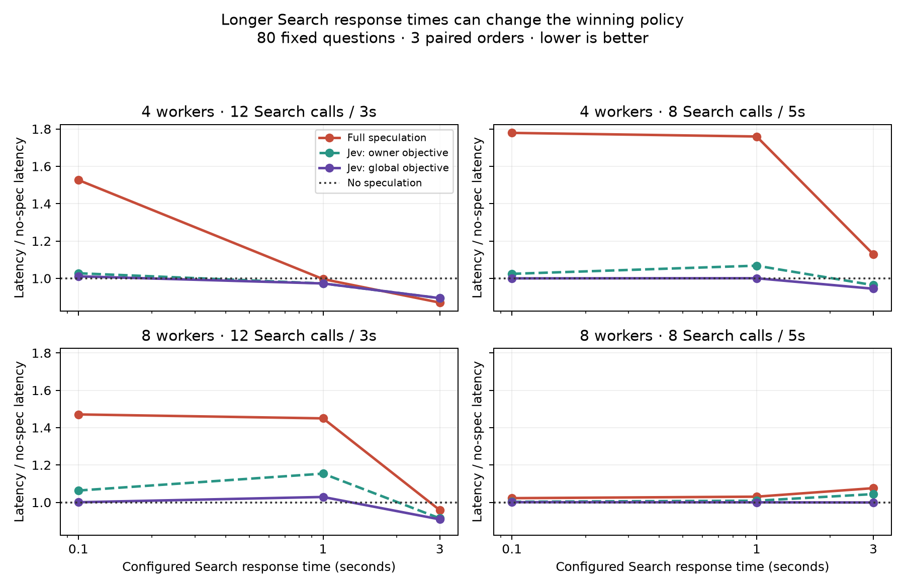

# Peer context and Search response-time experiments — November 17, 2026

Search response time changes which policy wins. Giving a language planner more peer information did **not** consistently improve speed. Jev's existing global objective remains the stronger option in the useful constrained scenarios below. No universal win is established.

**Follow-up:** [The explicit `quota_team` mode](QUOTA_TEAM_2026-11-17.md) now updates the query planner to reserve quota using observed peer demand, rather than an unconditional worker-count floor. The earlier measurements below retain their original archived prompts.

## How context is shared

There is one shared coordinator and Search quota, with an observed registry of active questions. Main agents do not exchange reasoning or receive quota/peer context. Only actual exact-query tool results may enter their trajectories.

| Component | Information currently available |
|---|---|
| Main actor | Its own question, returned tool observations and trajectory |
| Existing quota-aware query planner | Its hypothetical branch, capacity/remaining calls/refill timing, active worker counts, required queue and running counts |
| Jev demand predictor | One agent at a time: question, recent returned actions, last real result excerpt, completed calls, phase and elapsed time; owner's candidate only. Default `progress` context excludes actor intent. |
| Jev global admission | Forecasts from all active agents, shared quota, queued required calls and known executions; compares admitting/rejecting a candidate across all agents |
| New live `team` query planner | Existing quota context plus each peer's question, phase/elapsed time, completed calls, last eight returned actions, result excerpt and last **returned** actor intent |

This is a scheduler snapshot at a decision, rather than a conversation broadcast. Updates come from observed runtime events. Jev forecasts each worker independently; the admission calculation combines those forecasts. It does not send the entire team to Jev in a single joint prompt. Required calls retain FIFO priority, and speculative dispatch rechecks quota and candidate validity.

The new live option is `--speculation-planner team` with `--policy current_capacity`. It preserves the existing query-planner instructions and changes the supplied information. It is opt-in; Jev remains the default. Peer payloads are limited to 16 workers, 2,048 question characters and 1,024 characters each for result and returned intent. An independent audit reconstructs the peer payload from events and rejects fabricated intent. This does not share private in-flight reasoning.

## Controlled Search-time sweep: 80 questions

**Mean answer latency in seconds; lower is better.** Each row averages three paired question orders. The same 80 saved authoritative paths, observations, candidate searches and final answers are used throughout. This is a **counterfactual replay**, not a live Search benchmark. The configured delay replaces Search service time for both required and optional searches; local Lookup time stays unchanged.

| Workers | Quota | Search response | No speculation | Full | Jev owner objective | Jev global |
|---:|:---|---:|---:|---:|---:|---:|
| 4 | 8/5s | 0.1s | 8.57 | 15.24 | 8.77 | 8.57 |
| 4 | 8/5s | 1s | 8.70 | 15.31 | 9.29 | 8.70 |
| 4 | 8/5s | 3s | 14.36 | 16.21 | 13.84 | 13.56 |
| 4 | 12/3s | 0.1s | 4.21 | 6.43 | 4.33 | 4.26 |
| 4 | 12/3s | 1s | 7.36 | 7.33 | 7.16 | 7.16 |
| 4 | 12/3s | 3s | 14.36 | 12.49 | 12.84 | 12.84 |
| 8 | 8/5s | 0.1s | 16.68 | 17.05 | 16.73 | 16.69 |
| 8 | 8/5s | 1s | 16.83 | 17.34 | 16.98 | 16.83 |
| 8 | 8/5s | 3s | 17.26 | 18.57 | 18.02 | 17.25 |
| 8 | 12/3s | 0.1s | 6.75 | 9.93 | 7.18 | 6.75 |
| 8 | 12/3s | 1s | 7.38 | 10.70 | 8.52 | 7.60 |
| 8 | 12/3s | 3s | 14.36 | 13.76 | 13.13 | 13.05 |

The complete 1/2/4/6/8-worker results, including a nonbinding quota and native captured Search times, are in [the CSV](evidence/team-context-2026-11-17/latency-80-questions.csv). There are **900 schedules**: five worker counts × three quota settings × four service settings × three orders × five policies. Five policies include a full-speculation control with the same generation-step budget as Jev.

“Jev owner objective” is **not** a no-context ablation: it still receives the same forecasts and global risk checks. It scores gains only for the candidate owner. “Jev global” scores gains across workers. Their difference isolates the objective, not access to information.



Notable wins and failures:

- **4 workers, 8 calls/5s, 3s Search:** Jev global reduces mean latency **5.55% vs no speculation** and **16.32% vs full speculation**. All-background batch time falls from **294.13 / 332.04** seconds to **278.32** seconds, saving **5.38% / 16.18%**. It beats both baselines on both endpoints in each of the three orders.
- **8 workers, 12 calls/3s, 3s Search:** Jev global reduces mean latency **9.12% / 5.15%**, and batch time **9.59% / 4.60%**, against no/full respectively. Both endpoints favor Jev in all three orders. It also beats the equally budgeted full-speculation control on the aggregate endpoints, though by a smaller margin.
- **4 workers, 12 calls/3s, 3s Search:** full speculation wins. Jev is too selective and adds a decision delay in a regime where extra searches are affordable.
- **8 workers, 12 calls/3s, 1s Search:** no speculation wins. Jev global is faster than the owner objective (**7.60 vs 8.52s**) but still slower than no speculation (**7.38s**).
- **8 workers, 8 calls/5s, 3s Search:** Jev's mean is slightly lower than no speculation (**17.246 vs 17.260s**), but its batch is slower (**186.27 vs 185.88s**). This is **not** a win on both endpoints.
- Across all 60 worker/quota/service settings, seven aggregate settings beat both baselines on both endpoints. Several gains are tiny. All losing settings remain in the CSV; this is an exploratory map, not a new confirmatory claim selected in advance.

Full all-background batch times:

| Workers | Quota | Search response | No speculation | Full | Jev owner objective | Jev global |
|---:|:---|---:|---:|---:|---:|---:|
| 4 | 8/5s | 0.1s | 174.46 | 311.49 | 178.35 | 174.46 |
| 4 | 8/5s | 1s | 176.51 | 311.22 | 189.57 | 176.94 |
| 4 | 8/5s | 3s | 294.13 | 332.04 | 283.07 | 278.32 |
| 4 | 12/3s | 0.1s | 86.81 | 131.60 | 89.08 | 87.68 |
| 4 | 12/3s | 1s | 150.29 | 150.85 | 146.87 | 146.87 |
| 4 | 12/3s | 3s | 294.13 | 255.55 | 261.84 | 261.91 |
| 8 | 8/5s | 0.1s | 173.57 | 187.70 | 174.90 | 174.44 |
| 8 | 8/5s | 1s | 176.67 | 189.68 | 179.27 | 176.67 |
| 8 | 8/5s | 3s | 185.88 | 202.78 | 193.61 | 186.27 |
| 8 | 12/3s | 0.1s | 71.77 | 106.38 | 76.96 | 71.91 |
| 8 | 12/3s | 1s | 80.30 | 114.91 | 92.19 | 82.62 |
| 8 | 12/3s | 3s | 157.16 | 148.95 | 142.83 | 142.09 |

## Changing the language model's peer information: 8-question pilot

This is a separate, smaller cohort and must not be compared numerically with the 80-question table above. Each cell uses the same eight saved questions, one paired order, the same candidates, service setting and generation-step budget. The language model is asked to accept/reject an **already generated candidate**. This is a new admission gate, distinct from the existing live quota-aware **query generator**.

All three language gate variants have the same prompt, owner context, configured Search time and output schema. Only peer information changes:

- **Quota LLM:** quota and other-worker count.
- **+ peer progress:** each peer's phase, elapsed time and completed calls.
- **+ full peer context:** progress plus questions, returned search history, last actual result and last returned actor intent.

The gate uses actual paid Gemini 2.5 Flash calls, while the main actor paths are replayed. Every gate's measured end-to-end inference delay is charged asynchronously; authoritative work advances during it. The output schema permits only the supplied exact candidate or an empty list. Two earlier failed pilots that allowed query rewrites are excluded from performance comparisons and retained in costs/evidence.

Mean answer latency, seconds:

| Workers | Quota | Search response | No speculation | Full | Jev global | Quota LLM | + peer progress | + full peer context |
|---:|:---|---:|---:|---:|---:|---:|---:|---:|
| 4 | 8/5s | 0.1s | 5.79 | 8.95 | 5.79 | 8.14 | 7.08 | 7.45 |
| 4 | 8/5s | 3s | 12.35 | 12.64 | 11.03 | 13.07 | 12.13 | 12.52 |
| 4 | 12/3s | 0.1s | 3.65 | 3.85 | 3.65 | 3.65 | 3.63 | 3.63 |
| 4 | 12/3s | 3s | 12.35 | 10.37 | 10.62 | 10.50 | 10.53 | 10.67 |
| 8 | 8/5s | 0.1s | 7.45 | 9.08 | 7.45 | 8.59 | 8.47 | 9.11 |
| 8 | 8/5s | 3s | 13.10 | 12.98 | 12.88 | 13.21 | 13.21 | 13.21 |
| 8 | 12/3s | 0.1s | 3.95 | 4.16 | 3.94 | 4.01 | 4.16 | 4.16 |
| 8 | 12/3s | 3s | 12.35 | 10.55 | 11.94 | 10.67 | 11.27 | 10.68 |

Full peer context beats quota-only in three cells, ties in one, and loses in four. The progress-only version wins in four cells, ties in one, and loses in three. The full payload is slower than progress-only in four cells, ties in two and wins in two. These are single model samples per scheduling decision, so small differences do not establish an effect. **More context is not a demonstrated global speed improvement.** At 4 workers / 8 calls per 5s / 0.1s Search, progress-only improves on the quota gate, yet every language gate still loses to no speculation and Jev.

The paid gate pilot contains 24 language-policy schedules and 548 valid inference calls. Matching baseline/Jev schedules are independently audited. The merged table has 64 unique schedules; repeated baseline rows from separate collections are checked for exact agreement and deduplicated. Jev uses the same saved forecast bank as the large sweep.

A native live functionality check additionally ran the existing query generator with quota versus team context on eight new questions (dataset offsets 330–337), four workers, quota 8/5s. Both completed with zero actor or optional failures, passed the peer/quota/required-FIFO audits and made no Jev calls. Mean latencies were 11.48s quota and 10.92s team, but independent actor paths and provider timing make this descriptive only. It is not evidence that the team query generator causes a speedup.

## Controls and limits

All replay answers, authoritative actions and actual tool contents remain fixed. The saved candidates were generated before these policy comparisons; neither gate receives future authoritative actions, hidden reuse labels or final answers. Context audits verify that histories, results and intent correspond to actions already returned at the decision time. Required FIFO, quota windows, worker limits and exact candidate schema are independently checked. The broad sweep blocks network access and requires complete forecast coverage; it makes no new API calls.

Native actor and candidate-generation durations stay fixed. Jev probability calibration remains fitted only on the earlier 20 development questions, disjoint from the 80-question replay cohort. For a configured constant Search service time, forecast Search durations receive that same known configuration; empirical demand delays/probabilities are not refitted on evaluation outcomes. Recorded pooled Jev round-trip time and the current rollout computation time are charged. At native service time, empirical duration distributions remain unchanged.

This simulator assumes unlimited parallel provider service. It does not model connection-pool saturation, load-dependent API slowdown or transport failures. The new language gate is a one-order exploratory pilot; it is not a larger confirmation of the production quota-aware query planner. Some paid inference collections briefly overlapped the separate live functionality check, adding another source of provider timing variation. Fixed Search delays are sensitivity experiments, not new measured native latencies. Results support choosing a scheduling regime to investigate; they do not prove a live deployment win.

## Validation, spending and reproduction

**287 tests pass**, Ruff passes for 137 files, and all four independent replay audits pass. The live team audit also rejects a deliberately fabricated peer intent. All original recordings, incomplete attempts and schedules are retained. Replay schedules are gzip-compressed without changing their logical contents.

New API charges are **$0.27274865 across 825 calls**, including both failed admission pilots and the native live checks. There are no unknown-cost calls; receipts reconcile exactly with the provider account-usage delta. This includes 548 valid gate calls, 115 calls in failed pilots and 162 native functionality-check calls. No provider/key limit was changed.

Compact artifacts: [latency CSV](evidence/team-context-2026-11-17/latency-80-questions.csv), [context CSV](evidence/team-context-2026-11-17/context-8-questions.csv), [independent audits](evidence/team-context-2026-11-17/audits.json), [costs](evidence/team-context-2026-11-17/costs.json), [all seven aggregate dual wins](evidence/team-context-2026-11-17/dual-wins.json).

```sh
.venv/bin/python scripts/study_team_context.py sweep --output results/FRESH-latency
# With the already configured OpenRouter environment; this command spends API budget:
.venv/bin/python scripts/study_team_context.py paid --output results/FRESH-gates --count 8 --max-usd 1 --details quota phases team
.venv/bin/python scripts/smoke_live_team_context.py --output results/FRESH-live-smoke
```

The exact completed protocols, source snapshots, receipts and full schedules are under `results/team-context-2026-11-17-*`. Independent replay audit: `scripts/audit_team_context.py`. Aggregation and figure generation: `scripts/report_team_context.py`. The live query-planner option and the experimental fixed-candidate gate are both retained for further work; neither replaces Jev as the default.
